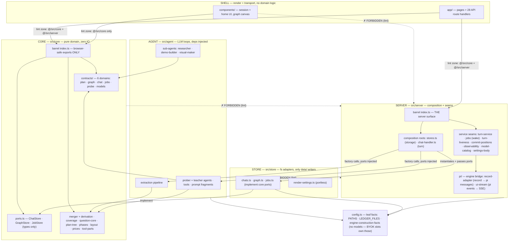
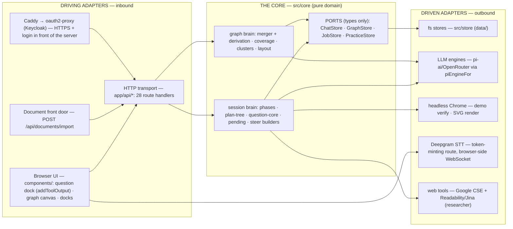
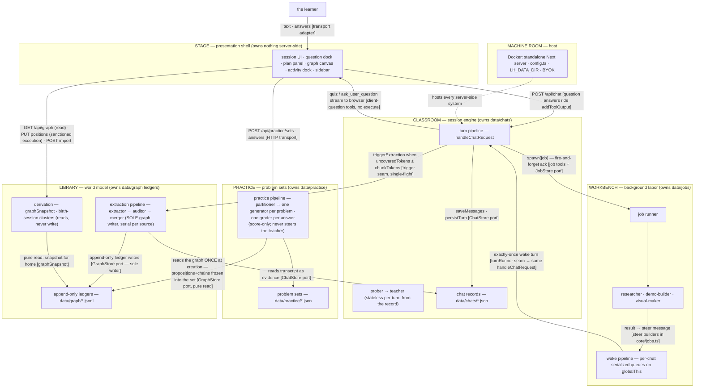
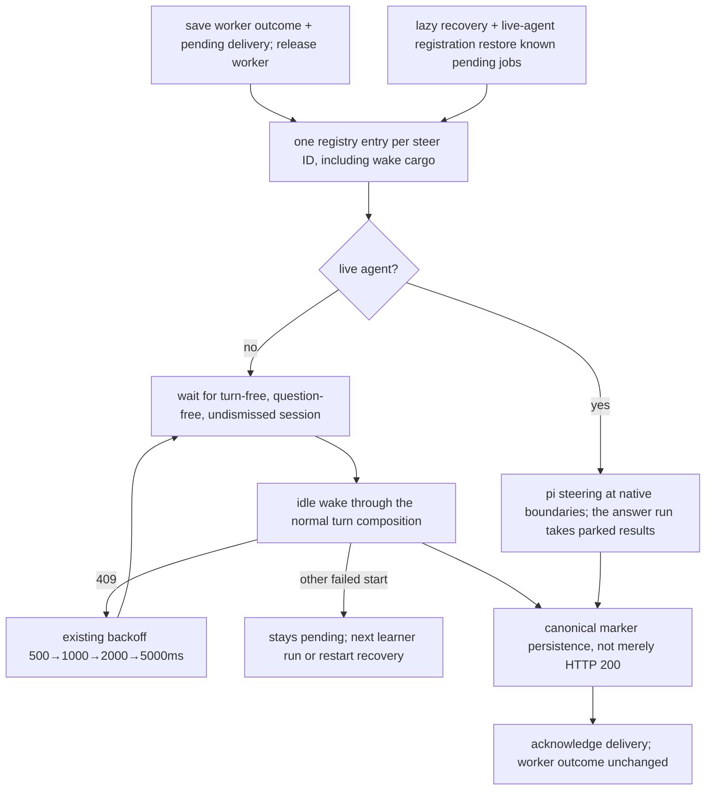
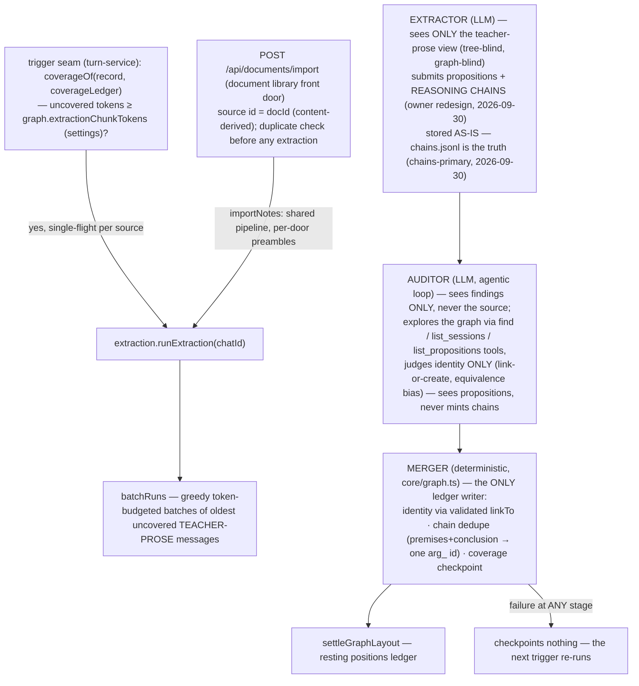
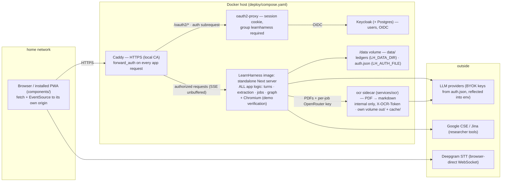

# Learning Harness — Architecture

Status: **the canonical architecture spec** — describes the as-built system, verified against the code by a full audit on 2026-09-18 (every file under `src/`, `app/`, `components/`, `scripts/`, the lint config, and the test suite; `lint` and `typecheck` clean on the audited tree). The pre-audit spec is archived at [`archive/architecture-2026-09-08.md`](archive/architecture-2026-09-08.md) — history only. Product reasoning lives in [`docs/vision.md`](vision.md); file-by-file layout lives in the README.

**What this is.** A self-hosted, browser-only learning app (Docker behind a Keycloak login — [`self-hosting.md`](self-hosting.md); the Electron desktop shell was removed 2026-10-25): the learner's knowledge accumulates into one persistent, cross-session knowledge graph, built from tutoring sessions in which a teacher agent authors a formal, visible dependency tree (the plan tree) and verifies understanding with structured questions. The graph is the home page; the session is the classroom; everything else serves those two.

**Design principles, in priority order:**

1. **Maximum control.** Every dependency edge is explicit and machine-checked. Nothing reaches sideways for convenience.
2. **Easy editability.** A worker can trace any behavior to one file. Layers are named by responsibility, not by framework accident.
3. **Zero technical debt.** The shape you see is the shape that runs. Deprecated paths are deleted, not parked.
4. **Crystal-clear architecture.** Two barrels as the entire public API, two composition roots, one writer per store, named seams. When a rule can be a lint rule, it is.

**The one-sentence model:** a pure domain core at the center; every external effect (fs, LLMs, browser, OS) behind an adapter at the edge; two composition roots as the only places the edges are plugged together; and every persistent store written by exactly one system.

---

## 1. Two axes, one law

Hold the architecture along two orthogonal axes:

**Static structure — the hexagon.** One pure core (`src/core`); everything else is an *adapter* (implements a core port or drives the core) or a *composition root* (the only code that wires adapters to core). Dependency arrows point **inward only** — toward purity, toward stability. Two barrels are the entire public API: `@/src/core` (browser-safe) and `@/src/server` (the server-side surface).

**Runtime ownership — six systems.** Each persistent store has exactly one owning writer-system; systems talk only through named, idempotent protocols:

| System | Owns (sole writer) | Role |
|---|---|---|
| **Classroom** — session engine | `data/chats/*.json` | the turn pipeline, prober→teacher, plan tree, questions, phases |
| **Workbench** — background labor | `data/jobs/*.json` | job runner, researcher/demo-builder/visual-maker, steer delivery |
| **Library** — world model | `data/graph/*` ledgers | extraction pipeline (sole graph writer), derivation, birth-session clusters |
| **Practice** — problem sets | `data/practice/*.json` | partitioner→generator→grader pipeline, self-contained sets (§7) |
| **Stage** — presentation shell | nothing server-side | components/, graph canvas, docks — pure consumer via `/api/*` |
| **Notifier** — Web Push | `data/push/*` (subscriptions, VAPID keys) | `src/server/push.ts`: device registration (`/api/push`) and fire-and-forget `notify()` from the turn-settle, job-finalize and extraction-finish seams |
| **Machine room** — host | process + config | Docker image (standalone Next server), the deploy/ stack (Caddy · oauth2-proxy · Keycloak), `config.ts`, data-dir seam, BYOK keys |

**The unifying law** (generates everything else): **imports point inward, writes point to append-only evidence, and everything else is derived.** Dependency flows toward purity; data flows toward evidence; no state is stored where it can be recomputed.

---

## 2. The layers and the import law

Dependency arrows point **down only**. Each layer may import the core barrel; nothing skips a boundary for convenience.

```
┌──────────────────────────────────────────────────────────────┐
│ SHELL      app/            Next.js route handlers (transport) │
│            components/     session + home UI (render only)    │
├──────────────────────────────────────────────────────────────┤
│ SERVER     src/server      composition roots (stores.ts,      │
│            chat-handler.ts) + named service seams + the      │
│            pi engine bridge. Zero business logic              │
├──────────────────────────────────────────────────────────────┤
│ AGENT      src/agent       prober + teacher loops, tool       │
│            surfaces, prompt fragments, sub-agents, the       │
│            extraction pipeline. Deps arrive via factories —  │
│            never imported from below                          │
├──────────────────────────────────────────────────────────────┤
│ CORE       src/core        pure domain: contracts (6 domains),│
│            ports, merger + derivation, coverage, question-   │
│            core, plan-tree, phases, layout, prices. No IO     │
│            (two files use node:crypto — pure                  │
│            but node-bound, hence kept out of the barrel)      │
├──────────────────────────────────────────────────────────────┤
│ STORE      src/store       fs adapters: chats · graph        │
│            ledgers · jobs (implement core ports) + two       │
│            portless settings adapters. The ONLY modules     │
│            that touch data/                                   │
└──────────────────────────────────────────────────────────────┘
```

**The import law** (`eslint.config.mjs` — the config's sole job; four `import/no-restricted-paths` zones, all `"error"`; each verified to fire; `lint` is a gate on every change):

| Zone | May import | Rationale |
|---|---|---|
| `components/**` | `@/src/core` only (the barrel) | The UI renders domain data; it never runs domain logic or touches IO |
| `app/**` | `@/src/core` + `@/src/server` (the barrels) | Route handlers are transport; they delegate to server entry points |
| `src/core/**` | nothing below itself (never `agent`/`server`/`store`) | The core is pure; adapters implement its ports, never the reverse |
| `src/agent/**` | never `server`/`store` | The agent layer receives its dependencies (ports, engines, seams) via factories/closures |



**Two rules are documentation-only by design.** The ESLint plugin's `except` can't express "all but one", so (a) `src/server/stores.ts` is *intended* to be the only server module importing adapters — but the server barrel also re-exports the two portless settings adapters and `observability.ts` imports `chatStore` directly; and (b) the browser-safety of the core barrel is a doc-comment convention (see §2.1). `tests/` and `scripts/` are deliberately outside the law (lint-excluded); tests import freely across layers, scripts act as extra composition roots.

### 2.1 The core barrel and browser-safety

`src/core/index.ts` exports only browser-safe modules — pure logic + types, no node builtins, no fs, no network. Deliberately **not** barrel-exported (server code imports them directly): `graph.ts` and `coverage.ts` (need `node:crypto`), `clusters.ts`, `session-clusters.ts` and `layout-settle.ts` (server-only roles). Port *types* are types-only, hence safe to re-export. This split is what lets the same core serve browser (grading, layout, plan statuses, cost folding) and server (merger, derivation, coverage). The interactive-exercise modules `math-expr.ts` and `exercise-core.ts` are barrel-exported and import no `node:*` module, because the browser and the server run the same graders (§5.2). `canvas-core.ts` (drawing scene contract) is barrel-exported too and hashes with a pure-JS SHA-256 instead of `node:crypto`.

### 2.2 Contracts — one file per domain

`src/core/contracts.ts` is a barrel over seven domain files, each owned outright by its stream (schema changes in a domain you don't own go through the master session):

- `contracts/plan.ts` — plan tree types + derived statuses (`derivePlanStatuses`)
- `contracts/graph.ts` — graph domain: ledgers, findings/audit shapes, snapshot, birth-session clusters
- `contracts/chat.ts` — session records, usage/money channel, settings, handoff text
- `contracts/jobs.ts` — the ack-and-steer protocol: job records, steer message builders, deterministic steer ids, usage accumulation
- `contracts/probe.ts` — probe assessment + the shared zod schema
- `contracts/models.ts` — client-safe model-catalog shapes
- `contracts/practice.ts` — problem sets, reasoning chains, params, grade scores

---

## 3. Ports, adapters, and the composition roots

Storage is **per-entity semantic ports**, never one generic interface: `ChatStore`, `GraphStore`, `JobStore`, `PracticeStore`, `PushStore`, `DocumentStore`, `DrawingStore`, `OkfBundleStore` (`src/core/ports.ts` — types only). The fs adapters (`src/store/{chats,graph,jobs,practice,push,documents,drawings,okf}.ts`) implement them and contain persistence and nothing else. One more adapter (`src/store/render-settings.ts`) is a portless free function re-exported through the server barrel — a deliberate pragmatic bypass, documented here so nobody mistakes it for the pattern.

**Idioms.** Graph evidence lives in **append-only JSONL ledgers** (corrupt-line-tolerant reads; strict shape guards drop invalid lines, never guess). Chats, jobs, positions, sources, and the settings blobs are whole-file read-modify-write JSON. All writes are synchronous, single-process (atomicity rides the Node event loop). Merge/dedup/derivation semantics are **reader-side, in core** — the store never decides.

- **`src/server/stores.ts` is THE composition root for storage**: it instantiates the adapters and hands the port objects to everything else (chat-handler, job runner, extraction pipeline, practice pipeline, graph/positions/chats routes, turn services). It is the single place a storage decision (JSON vs SQLite, local vs remote) gets re-made.
- **`src/server/chat-handler.ts` is THE composition root for a turn**: it wires the stores, the job runner, the extraction pipeline, the practice pipeline, and the pi engine into the stream response (`setTurnRunner`/`setJobRespawn` register its seams for the wake pipeline). All logic lives behind the seams it calls.
- The agent layer is dependency-inverted throughout: `createJobRunner({ chatStore, jobStore, deliver })`, `createExtractionPipeline({ chatStore, graphStore, extractor?, auditor?, embedder })`, `createTeacherTools({ chatId, chatStore, jobStore, spawn })`, `createProberAgent`/`createTeacherAgent(engine?, tools?, …)`. Tests inject the same ports production wires — or swap an in-memory port.

The engine side is adapted too: `src/agent/models.ts` (`piEngineFor`) resolves each role's engine from the user's **model slots** (BYOK: `settings.json` `models` section — strong/cheap/vision; a chain that ends empty refuses honestly with 503 `models_not_configured`) — and the teacher/prober conversation runs the **SESSION'S OWN record**: `POST /api/chats` stamps every newborn verbatim from the strong slot (the new-session default, chosen in setup), in-session picks write the session's record (`PUT /api/chats/:id/settings`), and the strong slot never reaches an existing session again (legacy unstamped records fall back to it at resolve time) — per-session models, owner 2026-09-28. Beyond the conversation, `src/server/pi/` bridges the two SDK worlds: `record-adapter.ts` (persisted UIMessage record → stateless pi `Message[]`, dangling tool calls get synthesized INTERRUPTED results) and `ui-stream.ts` (pi agent events → AI-SDK UIMessage SSE).



---

## 4. The six systems (runtime ownership and protocols)

The systems view: each box owns its store; edges are the protocols, each with the adapter/seam that implements it.



Four server-side systems, each the sole writer of its own store, connected by named protocols: the **turn request** (Stage→Classroom), the **ack-and-steer** loop (Classroom→Workbench→Classroom), the **extraction trigger + transcript read** (Classroom→Library), and the **practice request** (Stage→Practice over HTTP, plus Practice's one-time graph snapshot read at creation). The Stage touches systems only through the thin HTTP transport; the teacher reaches the Library directly through the gated prober tools (`list_sessions` / `list_propositions`) rather than any injected context.

---

## 5. The session (one chat turn)

`handleChatRequest` is framework-free (plain `Request`/`Response`) with a `buildAgent` test seam so tests drive it with scripted engines. The turn, in exact order:

```mermaid
sequenceDiagram
    participant B as Browser (useChat)
    participant R as POST /api/chat
    participant H as handleChatRequest
    participant L as turn-liveness (globalThis)
    participant CS as chatStore adapter
    participant A as prober/teacher agent (pi engine)
    participant F as onFinish seams

    B->>R: messages (+ graded question output via addToolOutput)
    R->>H: handleChatRequest(req)
    H->>L: beginTurn(chatId)
    Note over H,L: already running → 409; retryingFetch waits, re-fetches<br/>the record, merges unsent client messages by id, re-POSTs
    H->>H: claimSteers — coalesce queued steers into outgoing
    H->>CS: saveMessages (write-ahead: persist even before the stream)
    H->>A: build agent from record (probe_done part in transcript ⇒ teacher)
    Note over H,A: recordToPiMessages: stateless rebuild; dangling<br/>tool calls get synthesized INTERRUPTED results
    A-->>B: SSE stream (ui-stream bridge)
    Note over B: quiz / ask_user_question have NO server execute:<br/>rendered in the dock; graded client-side via question-core
    B->>B: QuestionDock: parse → shuffle (seeded) → buildAnswer (grade)
    B->>R: continuation (sendAutomaticallyWhen fires)
    A-->>F: onFinish
    F->>CS: persistTurn (canonical, idempotent) + appendTurnUsage
    F->>F: triggerExtraction — if uncovered tokens ≥ chunkTokens, fire async
    F->>L: endTurn (ALWAYS last — the registry never locks)
```

- **Client-side question tools** (`quiz`, `ask_user_question`) have no server execute: the call streams to the browser, the learner answers in the dock, the client grades via `question-core` and returns the verdict with `addToolOutput`, which fires the continuation. A pending quiz persisted in the record is exactly what makes **resume mid-question free**. Deterministic seeded shuffling (keyed by toolCallId) keeps server and client renders identical.
- **The prober→teacher handoff**: the first turn(s) run the prober (floor/ceiling via quiz, goal via ask); `probe_done` (server-executed) files the assessment and queues a handoff steer; from the first CONCLUDING `probe_done` result in the transcript (`isProbeConclusion` in `core/native-messages.ts`: a clean result whose details are not a `{ok:false}` refusal), the handler builds the teacher agent for every later turn. A refused call (an open question, an open canvas task, already concluded) concludes nothing: `hasProbeDone`, `phaseAt3Lh` and the view fold `phaseAt3` all skip it, and no handoff steer was queued for it. Phases (`core/phases.ts`) fold strictly: probe → plan → teach.
- **The formal plan tree is author-once**: the teacher authors the session's dependency map with a single schema-validated `plan_init` tool (a mermaid-subset graph, parsed deterministically with line-numbered errors, validated as a DAG). Progress is never mutated — statuses (`current`/`visited`/upcoming) are **derived** from tagged quiz calls in the transcript; the tree panel and the plan blocks render that derivation.
- **Runaway-turn guard (owner ruling 2026-10-27, "breaker + spend cap").** Overrides the older "maxTurns is gone" ruling (2026-09-25) only as follows. `src/agent/turn-guard.ts`, built per turn inside `baseAgentOptions` (prober, teacher and practice alike), never persisted. (1) *Identical-failure breaker:* within one turn, the same tool failing with the same canonicalized arguments (`canonicalJson`) a 3rd time gets the final refusal ("This call has failed 3 times with the same input. <tool> is unavailable for the rest of this turn. Continue without it or end the turn."), and the tool is refused immediately from then on (`beforeToolCall` block plus a `finishTurn` rewrite of the result, so schema-validation failures that never reach `execute` count and are rewritten too). Two further calls to the dropped tool in LATER steps (after the model saw the refusal; final review 2026-10-27: calls later in the same assistant message as the 3rd failure already ran, are never rewritten when they succeeded, and never count) end the turn through the same `finishTurn` "end" path as the question stopper; the settled turn persists with a short assistant notice ("The tutor got stuck on a tool call; the turn was stopped. Send a message to continue."). Counting is derived from the turn's own tool results: successes are never counted and reset nothing, so 20 successful reads in a row are untouched. Precedent: `GUARD_MAX_REFUSALS`. (2) *Per-turn spend cap:* `agent.turnSpendCapUsd` (default 0.50, 0 or absent = default, range 0.05-20; Settings → Agent). The handler binds `stepCost` to the money channel's `callCost` (`server/pricing.ts`, pi's catalog rates; no prices invented); each billed step adds its cost, unknown cost counts as 0, and once the total reaches the cap the turn ends after the current step with the notice "This turn reached your spend limit of $X (Settings → Agent). Send a message to continue." A posed question ending the turn outranks either notice. Wake/steer turns run through `handleChatInput`, so both rules cover them. Sub-agent jobs (`subagents/pi-run.ts` / `runner.ts`) are a separate loop and are NOT covered; they have their own `maxTurns`.
- **Visible feedback on every model (M4, 2026-10-27; RC4, RC9, RC10).** (1) *Dedupe after `send_to_user`:* `redundantTextBlocks(messages)` (`native-messages.ts`) walks the record turn by turn (spans between `isInputBoundary` messages); in a turn with a successful `send_to_user`, an ordinary text block of at least 5 tokens whose normalized token overlap with a message is >= 0.8 of the LONGER of the two token sets is redundant (final review, 2026-10-27: measuring against the shorter set hid a long teaching paragraph next to a short "Great work!" message; the longer-set rule bounds the size ratio to [0.8, 1.25], so only a near-restatement counts as a repeat, and neither a long text beside a short message nor a short line beside a long message is ever hidden). `projectView`, `hintsFor` and `sessionMarkdown` skip those blocks; a turn without `send_to_user` hides nothing (the #102 safety net), and a short meta line ("I marked up your sketch...") that is not a duplicate stays. Coverage (`coverage.ts`) deliberately keeps counting both, since a repeat only brings an extraction chunk slightly earlier and never loses teaching. (2) *Silent-turn re-prompt:* `src/agent/turn-nudge.ts`; in `finishTurn`, a natural end (stop, no tool calls) after a `work-submission` or `hint-request` with no prose, no `send_to_user` text and no posed question/task queues ONE hidden steer through pi's follow-up queue ("The learner saw only your marks/grade - tell him in plain text what you saw and what to do next."). The steer is a `turn-nudge` marker, stripped from the agent's state at `agent_end`, so it never reaches the record or the transcript. (3) *Plan written as prose:* the same hook, after a `probe-handoff` turn that ended with a mermaid/`graph TD` diagram and no successful `plan_init`, queues "Call plan_init with that plan." At most one steer per turn across both rules. (4) *Empty-error retry:* `withEmptyErrorRetry` wraps the engine stream function: a step that errors with no content (only a `start` event at most), a transient-looking message (abort, timeout, network, 408/429/5xx, or none) and no learner abort is retried once per turn (the pi loop treats error steps as hard exits, so the retry lives at the stream seam). (5) *Interrupted probe question:* `probe_done` gates on `openQuestionOf`, which treats a dangling question followed by a later user message as resolved (`danglingQuestionOf` itself is unchanged: the dismiss routes still need it).
- **Job tools are server-executed, ack-and-steer**: `research`/`demo`/`visual` resolve immediately mid-turn with a fire-and-forget ack (the teacher keeps teaching); `spawn(job, input)` fires the background runner.
- **The turn services are named seams with explicit dependencies, and only the side channels swallow errors.** Extraction and attribution log one `[chat <id>]` line and never touch the response. The two canonical writes do not fail quietly. If the write-ahead save of the learner's input throws, the POST answers 500 ("Your input could not be saved") and no agent starts. If `persistTurn` cannot save the reply, it throws `TurnPersistenceError`, and `ui-stream.ts` streams that error before `[DONE]`. Whatever step of settlement throws, the handler's `onSettleFailure` still ends the turn (liveness, the run registry, the live agent) and reconciles user steers and steer markers against the saved record, so a failed bookkeeping step never resends input that already landed.
- **A settlement failure outlives the stream that carried it.** `turn-runs.ts` keeps one error string per chat in memory (`rememberTurnFailure`). A view that attaches after the turn left the registry gets it as an `error` event ahead of `turn-settled` (`settledTurnResponse(chatId)`), and `GET /api/chats/[id]` returns it as `turnError` for views that only refetch. The chat view shows it in the usual error banner. The next accepted turn (`beginTurn`), deleting the session, or a server restart clears it. It is never written to the transcript and never triggers an automatic model retry.
- **The client does not resend an answer it cannot account for.** `components/session-core.ts` keeps each submitted question draft in memory, so the question dock can restore it when acceptance failed. Submitting an answer again from the error state first refetches the record: if a turn is running the view reattaches, and if that question is already answered or no longer the open one, the view adopts the record and sends nothing. A stream that ends without its terminal (EOF or a failed read) gets one read-only reattachment; a second transport failure shows "The connection dropped before the turn completed." rather than pretending the turn finished.

### 5.1 The wake pipeline (Workbench → Classroom)

**Worker completion and session delivery are separate lifecycles.** Dispatch persists the tool input on the job (`JobRecord.input`) before spawning. When a research, demo (including a failed Chromium verification, which lands as a failure result) or visual worker finishes, the runner saves the result, the terminal worker status (`done`/`error`) and `delivery: {kind: "result", status: "pending"}` in one job-record update, then queues the native custom steer message without awaiting delivery. The marker's content is the model-facing text; its details carry the UI artifact. The worker's abort registration is released at that point, so the Background agents row disappears even if an unanswered question holds the result. Dispatch cards read "finished", not "delivered". Only computing workers can be aborted; an abort saves its own pending abort notice. Retired `pdf` job records still load; they are never replayed.



The per-chat registry keeps one entry per deterministic steer id (`steer_<jobId>`) across live handoff, idle-wake flight and a 409 return, so repeated submissions share it. A saved marker with that id in the conversation completes delivery; streaming visibility or HTTP 200 alone does not. A failed acknowledgement cannot replay a saved marker, and a later teaching failure does not reopen delivery. A failed wake start leaves the result durably pending with no new error UI or timer, until the next learner run or a process restart. Normal question and dismissal waits are not failures: the dismissal pause still holds every marker until the learner's next send. A completed delivery fires the job push notification (side channel).

Recovery reads saved job input before the legacy transcript lookup; a missing research question fails honestly without invoking the researcher. Legacy running jobs that hold a saved result become finished workers with pending delivery; legacy terminal jobs without delivery metadata are left untouched rather than guessed to owe a delivery. Pending result and abort notices are restored when a new agent registers, before its first steering poll, even without a preceding jobs-feed read. Deleting a session discards its pending obligations; only live turns and computing workers block deletion. This rests on the existing JSON storage and a single-process registry, not a transactional queue.

Sub-agents **verify, never one-shot**: the demo-builder headlessly executes its HTML in system Chrome before delivery; the visual-maker renders each SVG and looks at it (needs a vision-capable model — the `vision` slot in settings).

---

### 5.2 Interactive exercises (PR 1: core formats)

A third question instrument beside quiz/explain and ask: the learner **produces** an answer in a structured widget, and deterministic code grades it. The formats with a grader in this build are `numeric`, `blanks`, `table` and `multipart` (`IMPLEMENTED_FORMATS`); `INTERACTIVE_FORMATS` already names the later ones so old records keep parsing.

- **Tools.** The teacher holds `exercise` (with `type` predict/check and a plan `nodeId`), the prober holds `assess` (no `type`, no `nodeId`; the same name split as `quiz`/`probe` and `explain`/`recall`). Practice has no third tool: the `problem` tool takes an optional `format` + `spec` pair (both or neither). All three validate the spec in `execute` (`exerciseSpecProblems`; a number or expression key must itself parse, and an expression key may use only its declared `variables`), require 2 or 3 `hints`, and refuse a hint that contains an accepted value as a whole token (`hintLeaks`). Each takes the optional `requireThinking`, as quiz and explain do. The tools exist only when at least one format is enabled.
- **Teach-phase guard.** A teach `exercise` with `type: "check"` goes through the same guard as quiz and explain (`teachGuardFor` in `src/agent/tools.ts`): it is refused when no visible teaching reached the learner since the last input, and the third attempt passes with a warning. Predictions and the prober's `assess` are never guarded.
- **The browser grades.** `exercise`/`assess` have no server-side grading, like quiz: the dock (`components/question-dock.tsx`, widgets in `components/exercise/`) grades every Check with `gradeExercise` and keeps only the marks (`stripExpected`), so the expected values never reach the DOM before the loop closes. A correct Check, Submit, or "Show answer" (`gaveUp`) closes the loop; `buildExerciseAnswer` (`question-core.ts`) then builds the answer record with the full verdict, `attempts`, `hintsUsed`, `gaveUp` and `firstAttempt`. `compactAnswerForModel` strips the expected values from what the model reads (it wrote the key).
- **Couldn't read is not wrong.** Before grading a Check, the docks ask `unreadableItems` for filled number/expression entries that do not parse ("1 000", "1,000", "2 3"). Those refuse the Check with a "couldn't read" notice, and the Check does not count as an attempt. `math-expr.ts` normalises common typed notation first (× · ⋅ → `*`, ÷ → `/`, superscripts → `^`, √ → `sqrt`, bare function arguments like `sinx`), so right answers in everyday notation grade right.
- **The server re-grades practice Checks.** In practice, a Check rides the thinking input as a `ThinkingAttempt` (`{format, response, verdict}`). `parseChatInput` shape-checks it, and `inputAppends` re-grades it against the active problem's own spec (`verifiedAttempt` in `src/core/input-events.ts`). A claimed verdict that does not match the server's grade is a 400. The recorded verdict is always the server's, marks-only.
- **Marks only until `conclude`.** The `practice-thinking` marker's `details.attempt` stores the marks-only verdict, and its content adds an `Attempt:` line with the summary and a per-item ✓/✗ list for the model, never the expected values. The answer key appears only when `conclude` reveals the problem (`keyResponse` renders it in the conclude card).
- **Settings.** `agent.formats` is a boolean delta map keyed by format name. An absent key means enabled. `enabledFormats(effective)` (`settings-resolution.ts`) resolves it, and the chat handler passes the list to the prober, teacher and practice tool contexts. The settings page groups the toggles under "Question formats".
- **Evidence.** `gradedItems` (`src/core/learner.ts`) reads answered `exercise`/`assess` calls through `exerciseItem` (kinds `exercise` and `assess`; predictions skipped). A first-try correct answer without hints is `clean` (or `tentative`/weak at low confidence). A correct answer after retries or hints is `correctWithHelp` (weak). `partly` is weak. A wrong answer is `miss` and a give-up is `surrendered`, both failed, with the first wrong item of the first attempt as the misconception.
- **Display.** `parseExerciseInput` (`tool-parts.ts`) is the lenient display parse of persisted calls. The plan statuses (`contracts/plan.ts`) and the phase fold (`phases.ts`) count `tool-exercise` parts as they count `tool-quiz` and `tool-explain`.

---

### 5.3 Canvas tasks: `work` / `sketch` (PR 2)

A canvas task is multi-turn and coached: the agent poses ONE task, the learner works on the canvas, submits (text and/or a drawing) as often as they like, the agent coaches between submissions, and `grade` (or a dismissal) closes it. Everything is a fold over the record; nothing is tracked.

- **Tools.** The teacher holds `work` (`type` predict/check, plan `nodeId`, `question`, `correctAnswer`, optional `requireThinking`/`details`/`concepts`), the prober holds `sketch` (no `type`, no `nodeId`). `src/agent/tools/work.ts`. Both exist only on a canvas-capable turn: `canvas = record.settings.canvas === true && canvasCapable === true && a vetted canvas model resolves` in `handleChatInput` (see the next-but-one bullets: the canvas model). `canvasCapable` is the POST body's device report beside `input`; the wake pipeline (`setTurnRunner`) always passes `false`.
- **The pose.** `work`/`sketch` return `workResult()` (terminate, persisted ack with `details: null`, as the practice `problem`). `needsContinuation` owes nothing after a clean work/sketch ack, and `makeQuestionStopper` ends the turn on it, mixed batches included. The view treats the ack as a placeholder (`isPlaceholderResultTool`): the part stays `input-available`.
- **The open task.** `activeWorkOf(messages)` = the newest cleanly-acked work/sketch call that no clean `grade` call (`question === toolCallId`) and no `work-dismissed` marker has closed. A second pose is refused while one is open (the tool also reads the turn's `WorkGate`, so a `grade` then a new pose in ONE turn works: the stored record only refreshes at settle). `probe_done` is refused while one is open, and reads the same `WorkGate` (a sketch graded earlier in the same turn no longer blocks it); its refusal concludes nothing (§3, `isProbeConclusion`).
- **The model is told the task id.** `grade` closes a task only by its exact tool-call id, which a model never sees otherwise. The pose ack (`workResult(toolCallId)`) and every submission marker (`workTaskLine`) name it, and `grade`'s "not an answered question" refusal lists what is gradable now (`ungradedAnsweredRecalls`, with tool names), so a wrong guess is fixed in one retry. Side questions (quiz, explain, exercise, ask) stay allowed.
- **Hints stay in the canvas.** The Hint button no longer minimises the workspace. `hintsFor(messages, callId)` folds the record: each `hint-request` marker for the task (a work/sketch call id, or the practice problem's) pairs with the learner-facing text of the assistant messages up to the next input boundary; a failed `send_to_user` does not count. The boundary is one exported predicate, `isInputBoundary` (`native-messages.ts`): a user message, any marker except the UI-only `plan-block` (the learner's own markers, and also a job's `subagent-steer`/`subagent-abort`, `probe-handoff`, `graph-context` and `compaction`), or a clean question answer. A wake turn's job commentary therefore never joins a hint, whether the steer starts a wake turn or rides the hint turn as a follow-up. The teach-phase guard (`visibleTeachingSinceLastInput`) and the workspace's pending check use the same predicate. Known edge: a steer that rides the hint turn before any hint text is delivered (behind a tool call, or a deferred re-delivery on the first call) closes the window early, so that hint reads as having no reply in the canvas; the transcript still shows it. The workspace shows the newest hint in a collapsible, height-capped strip above "Your thinking" ("Getting a hint…" while the newest request is the latest input boundary and a turn runs), and a toolbar "i" with a count badge opens a panel of all hints, oldest first; both render nothing without a hint. Esc closes that panel before it minimises.
- **Inputs and markers.** `work-submit {workCallId, text, drawingId?}` is validated against `activeWorkOf`, refused while `danglingQuestionOf` is non-null (the side question answers first) and, through the injected `drawingExists`, refused for an unknown drawing; it appends a `work-submission` marker (content `Your thinking:\n<text>` plus `\n[drawing <id>]`). `hint {callId}` (the active task or the active practice problem; also refused while a question dangles) appends a numbered `hint-request` marker, `details {callId, n}` and text `Hint request <n> for this task — give the next rung only.`, where `n` is `nextHintNumber(record, callId)` (earlier hint-requests for that call, plus one; derived at creation, also on the client's optimistic copy). Markers written before numbering keep their old text `Hint, please — give the next rung only.` and still pair in `hintsFor`. `dismiss-work {workCallId}` is a silent dismissal (ask-style like `dismiss-problem`: it parks mid-turn and applies at settle through the same `dismissAppends`) that appends `work-dismissed`; `endsInDismissal` is true when the record ends on it, so job deliveries hold until the learner's next send. The view projects `data-work-submission` and `data-work-dismissed`; a hint request shows no bubble.
- **`grade` closes work.** `answeredRecallIds` / `ungradedAnsweredRecalls` include work/sketch calls with at least one submission, so `grade{question: workCallId}` is valid; it takes an optional `rung` (R0-R5 or null) for the highest hint rung given. `grade` is registered whenever the canvas is on for the turn or a task is open, whatever the device (a phone turn has no `work`, but can still grade a task opened on a tablet).
- **Evidence.** `gradedItems` yields kind `work`/`sketch` (predictions skipped, ungraded work produces nothing): answer = the last submission's text plus `[drawing]` when it carried one. Correct at rung R2 or above is raw `correctWithHelp`, weak; other grades map as for explain.
- **Teach guard and position.** `teachGuardFor` covers `work` with `type: "check"` (predictions exempt). A tagged `work` moves the plan position and flips plan→teach like `explain` (`phases.ts`, `contracts/plan.ts`).
- **Markdown.** `session-markdown.ts` renders the pose (`Canvas task`), each submission with ``, and `annotate` mark lists.
- **Drawings in the model context.** `toLlmMessages(messages, {drawing?: DrawingContext})` is the one seam. Only the NEWEST `work-submission` / `practice-thinking` marker whose `drawingId` belongs to the active task (`activeWorkOf` / `activeProblemOf`) is sent as an image (text = marker content + `GRID_NOTE` + the structured text: typed objects, then the **stroke digest (M5)**, one `[s4 blue stroke, vertical line @D1-D5]` line per non-empty freehand stroke in id order, capped at `MAX_STROKE_DIGEST_LINES` (40) with a `+N more strokes` tail (over the cap `digestStrokes` keeps the 40 LONGEST strokes by path length, ties by id, still listed in id order, so a curve or axis drawn after a lot of handwriting is never cut in favour of short ticks; final review 2026-10-27); the colour is the palette name and the shape hint comes from `strokeShapeHint`, a pure reading of the points: vertical/horizontal line, line, closed loop, `curve, top|bottom at <cell>`, else freehand. It exists because models anchored on label positions and misjudged where a freehand peak sat. The vision-slot transcriber receives the same text, so the text-only path carries the digest too); earlier submissions of that task become `[earlier drawing <id> — superseded]` plus structured text; a closed task's markers become `[Drawing <id> omitted — task closed]` plus structured text. `server/drawing-context.ts` `prepareDrawingContext` builds the resolver per turn (awaited in `handleChatRequest`, passed as `AgentBuildOptions.drawing`): a model with `image` input reads the PNG; a text-only model gets the newest active drawing transcribed BEFORE the turn by the `transcriber` role (vision slot, `agent/subagents/drawing-transcriber.ts`, per-role override like the other background roles), cached in `<drw_id>.transcript.json` so each drawing is transcribed once. A failed or unconfigured transcription is contained: the model sees `[Drawing <id>: transcription unavailable]` plus the structured text. `ESTIMATED_IMAGE_CHARS` (compaction) is 11 200 (about 2 800 tokens).
- **Canvas engine.** `components/canvas/` is the drawing surface, a shell (render-only) module that imports only the `@/src/core` barrel. `geometry.ts` is pure and unit-tested (`tests/canvas-geometry.test.ts`): `touchRole`, screen/world maps, `hitTest`/`eraseAt` (whole objects, no splitting), `strokeOutline` on `perfect-freehand` (pen/pencil/marker presets), `quantizePoint` (x/y 0.1, pressure 0.01), the theme-neutral palette (`screenColor` per theme, `exportColor` always the light set) and `visibleObjects` viewport culling. `canvas-engine.ts` (`CanvasEngine`) owns two stacked canvases (cached static layer, live stroke layer, `desynchronized` only when confirmed), rAF-batched redraw, a 100-deep scene-snapshot undo/redo and `exportPng` (scene box at 2x, long side at most 2048 px, dark ink on white, region grid plus `oN` badges). Pointer handling never touches React state: the owner learns of finished work through `onChange`/`onPlace`/`onSelect`. Zoom and pinch reuse `zoomedGraphView`/`pinchView` from `components/pan-zoom.ts` (floor 0.1, shared `ZOOM_MAX`). Invariant: `penSeen` latches on the first pen event; afterwards one finger pans and touch never draws, and two touches always pan and pinch.
- **Canvas workspace and docks.** `components/canvas/canvas-workspace.tsx` is a session-area overlay mounted in `chat.tsx` beside `MermaidOverlay` (never `fixed inset-0`; `useBackDismiss`; Esc claimed at the document level so one Esc minimises). It loads the draft on open and autosaves through `PUT drafts/<callId>` (2 s debounce, revisioned; a 409 loads the newer draft with the notice "Updated from your other device"); every change is mirrored to `localStorage` (`lh:draft:<chatId>:<callId>`) and `pickDraft` (`canvas/draft.ts`, pure) lets the newer of server and local win. Submit exports the PNG, POSTs `/drawings`, then hands the `drawingId` to the host (`work-submit`, or `thinking` with `drawingId` for a practice problem posed with `canvas: true`); an empty scene submits text only; `requireThinking` gates it. `canvas-objects.tsx` renders typed objects as world-positioned overlay editors (learner-authored: markdown through `MessageResponse`, LaTeX through `katex` with `trust: false`, tables, images via the assets route; edits commit on blur through `CanvasEngine.applyScene`, one undo step each). Dock priority is the pure `dockKindOf`: pending side question, then open work task (`WorkDock`, a minimised bar with "Open canvas" or, on a phone, a text-only fallback), then active practice problem, then composer. Capability is `useCanvasCapable` (physical short screen side at least 600); `SessionModel` sends `canvasCapable` with every chat POST. The Canvas pill (`CanvasPill`, `data-testid="stats-canvas"`) is draft state sent as `canvas` on `POST /api/chats`, or `PUT {canvas}` in a session. `projectView` joins the committed `correctAnswer` onto the `grade` part that closes a canvas task (`workAnswerForGrade`), which `GradeChip` reveals. A practice `problem` accepts `canvas: true` only when the session canvas is on for the turn.
- **Teacher ink: `annotate` (PR 3).** `src/agent/tools/annotate.ts`: input `{drawingId, marks[1..20]}`; a mark is `kind` (circle/underline/check/cross/note/arrow), a `target` (or `from`/`to` for an arrow) anchored to `{object}` / `{stroke: "s4"}` / `{cell}` / `{cells: "B2:D3"}` (a `stroke` target resolves to the stroke's bounding rect and must name a non-empty stroke; refusals append `stroke ids: ...`, capped to the same `digestStrokes` set the model sees with a `(+N more short strokes)` tail, while any non-empty stroke id still resolves; `objectRect` returns null for a stroke with no points), and an optional `label` (80 chars). Non-terminating; it writes nothing, the marks live only in the call. It validates the drawing belongs to the chat (`DrawingStore.getScene(chatId, id)`) and every mark against that scene and its `sceneBoundingBox` (`annotationMarkProblems` in `canvas-core.ts`); every refusal names the valid ids (the chat's drawing ids, the grid `A1 to H<rows>`, the range syntax `B2:D3`, the typed object ids) so a model that guessed wrong can retry. `resolveTargetRect(target, scene, box)` maps a target to a world rectangle: a range is the union of its corner cells, order-insensitive, and its separator may be `:`, `-` (the dash the structured text writes spans with, `[o1 text @B6-D7]`) or an en/em dash; `cell` and `cells` resolve alike (a range in `cell` is a range, one cell in `cells` is a cell). A string that is neither a cell nor a range is refused with `a cell is written C4 and ranges are written B2:D3`. **Heal parity (the tool-parts law).** The input schema (`annotateInputSchema`) and the heal (`healAnnotateArguments`: the standard top-level pass, so `marks` sent as a JSON string, plus this tool's nested wobbles, a mark or a `target`/`from`/`to` sent as a JSON-encoded object and optional fields sent as null, plus the cross-model anchor heal (M1): a NON-arrow mark with no `target` and exactly one of `from`/`to` moves it into `target`, and bare `object`/`cell`/`cells` keys on a mark are wrapped into `target`; arrows keep from/to, an arrow with only `target` is refused, and a non-arrow mark still carrying from/to is refused with `only arrows take from/to - rename \`from\` to \`target\``) live in `canvas-core.ts`. The tool runs the heal as its `prepareArguments`; every reader of the record goes through `parseAnnotateInput` (heal, then the boundary's Convert + Check against the same schema, then the structural mark shape), because the record keeps the RAW arguments. `annotationsOf(messages, drawingId)` is the pure derived fold over successful `annotate` calls, read through `parseAnnotateInput`: a call with no result, an `isError` result or a `{ok:false}` result is ignored, and a call that succeeded on healed arguments folds to its marks. Any new fold over recorded tool-call arguments must read them through the same heal the boundary ran. Registered (teacher, prober, practice) by `annotateToolsFor` when `drawingStore` is wired and the turn is canvas-capable or the record already holds a drawing marker; `drawingStore` comes from `handleChatInput`. The mechanics live in `shared/24-canvas-tools.md` (teacher, prober) and inline in `practice/00-base.md` (practice gets no `shared/` canvas fragment). **First-submission grade refusal (M3).** `grade` refuses wrong/partly once on an uncoached first work/sketch submission; the prober applies it too (it gets the same late-bound turn view as the teacher, `createProberAgent`, so a refusal or coaching earlier in the same turn is seen and the refusal fires at most once per task). **Grade heal (M1).** `healGradeArguments` (`src/core/grade-heal.ts`, pure, exported by the core barrel) runs as the `grade` tool's `prepareArguments` AND on every read of a recorded grade call (`gradesOf` in `core/learner.ts`, `GradeChip`): a `note` over `GRADE_NOTE_MAX` (140) is cut at a word boundary with an ellipsis inside the limit (never refused), and a `misconception` sent with grade `correct` or `dontKnow` is dropped (never refused, never reaches the evidence). **Ink layer (UI).** `components/canvas/teacher-ink.tsx` `TeacherInk({marks, scene, box, space, theme})` resolves each mark through `resolveTargetRect` (an unresolved target is skipped) and draws it in the `TEACHER_INK_COLOR` palette name (`geometry.ts`, via `screenColor`): circle = ellipse around the rect, underline = bottom edge, check/cross = glyph paths at the top-right, note = label badge, arrow = rect centre to rect centre. `space: "world"` returns a `<g>` for an svg carrying the viewport transform; `"percent"` returns an `<svg>` over a thumbnail (percent of box width on both axes). `submittedDrawingIds(messages, taskCallId)` (core) lists a task's submissions. The workspace derives marks from the `messages` prop (`annotationsOf` per submitted drawing), anchors cells to the submitted scene's grid box (`useDrawingScene`, immutable, cached) and resolves object ids against the live scene first; a "Teacher marks" toggle shows only when a successful annotate exists. `DrawingThumb` reads the record through `SessionMessagesContext` (provided by `chat.tsx`) and overlays the marks in percent space; `AnnotateCard` (registered as `annotate`) lists the marks through `parseAnnotateInput` + `annotationMarkPlace` and renders nothing for a refused call; `session-markdown.ts` renders the same mark lines (`- circle o2: label`) under `Marked up`.
- **Doctrine weaker models follow.** The teach guard's refusal for `work`/`quiz` checks adds "If this task comes before you teach the step, pose it with type predict instead" (mirrored in 24-canvas-tools.md under "When to pose it"). `grade` wrong/partly on a `work`/`sketch` task (not a `predict`) with exactly one submission and no `visibleTeachingSinceLastInput` since it is refused once ("Coach this first submission and leave the task open; ..."); "once" is derived from the record plus the in-flight turn: an errored `grade` call for that task already present means no second refusal. `grade` correct is never refused. The numbered hint rule (hint n is rung n; a hint never states a value the task asks him to produce) is in 24-canvas-tools.md and mirrored into `practice/`, which does not get the shared canvas file.
- **The canvas model and the vetted-model allowlist (M7).** Canvas is offered only on models it was tested on. `CANVAS_VETTED_MODELS` (`core/settings.ts`, provider + id + a "tested <date>" note) is the allowlist: glm-5.3-flash, qwen3.8-flash and deepseek-v4.1-flash on OpenRouter (M6 matrix, 2026-10-27) and claude-sonnet-5-5 (the 0.24.0 control run, not re-tested). Haiku, Gemini, Kimi, Qwen max/27b and every openai/* model are NOT on it. A fourth model slot, `models.canvas` (optional, never part of the first-run gate `slotsConfigured`, no agent role maps to it), names the model that handles canvas turns. `resolveCanvasModel(slots, keyPresent)` (`core/settings-resolution.ts`, pure) resolves it: the explicit slot, else the default `openrouter z-ai/glm-5.3-flash` (`CANVAS_DEFAULT_MODEL`) when an OpenRouter key exists, else the strong slot, taking the first that is allowlisted AND has its provider key; none means the canvas is unavailable. The slot write (`parseModelsSettingsBody`) rejects a non-allowlisted model, and a hand-edited one is ignored at resolution. Older settings files without the key keep loading unchanged (`tests/golden-fixtures.test.ts`). **Per-turn model.** `isCanvasInput(messages, input)` (`core/input-events.ts`) marks canvas input: a `work-submit`, a `hint` on the open canvas task or on a practice problem posed with `canvas: true`, a practice `thinking` carrying a `drawingId`. Such a turn runs on the canvas model (same thinking-level rules: the slot's level, else `DEFAULT_THINKING_ORDER`); posing the task and every other turn stay on the tutor (the chat's pin over the strong slot). The per-turn engine feeds the whole turn: the usage stamp and spend-cap price (`modelId`), the drawing context (image or vision transcript), and the `send_to_user` gate (`teacher-agent.ts` keys on `engine.model.id`, so it is decided per turn model). Compaction stays on the tutor. A per-chat model pin pins the TUTOR only; the canvas slot is global for now. **Gating.** If no vetted model resolves, `work`/`sketch`/`annotate` are not registered and practice does not pose `canvas: true`; `GET /api/models` carries `canvas` (the model in force, or null) and the Canvas pill reads it, showing disabled with "Canvas needs a tested model — set one in Settings → Models → Canvas". Settings → Models → Canvas offers only allowlisted models. Adding a model to the list means re-running the canvas matrix on it first and checking its context window (compaction uses the tutor's window, so a smaller canvas window could overflow on a long chat; all four entries report >= 1M in pi's catalog). GLM's entry carries an open condition: in M6 it stated the target in coaching and in a hint; the no-give-away rung was re-checked live on it only n=1 (coaching after a wrong submission passed; the hint only on a task with no submission), so a hint after a coached wrong submission is unverified until re-run or accepted by the owner (see its note).
- **Prompt mechanics and fixtures.** `prompts/shared/24-canvas-tools.md` carries the mechanics only (when to pose the canvas tool, repeated submissions and closing with `grade`, the labelled grid and `oN` ids, typed objects as verbatim structured text); it says "the canvas tool" because `work` and `sketch` differ by phase, and `tests/question-tools.test.ts` pins that it cites only real names. `prompts/practice/00-base.md` documents `problem`'s `canvas` flag. For `annotate` both say: prefer the object id for typed objects, ink handwriting with a cell or range, keep to a few marks, and annotate before `grade` (practice: before `conclude`) in the same turn. The golden fixtures gained a canvas chat (`work-submission` with drawings, including a resubmission of an unchanged scene that reuses its content-addressed id; `hint-request`, `work-dismissed`, refused-then-concluding `probe_done`) and its `drawings/<chatId>/` folder (scenes, browser-exported PNGs with the region grid and `oN` badges, drafts); `EXPECTED` in `tests/golden-fixtures.test.ts` lists the three new markers.

---

## 6. The knowledge graph — two channels, one writer

**The extraction pipeline is the sole graph writer.** Nothing else appends to `data/graph/*.jsonl` — not the teacher, not the server, not a migration script. (The one sanctioned exception: `PUT /api/graph/positions` writes layout positions only, sanitized, with an incremental layout settle when the graph grew. Backfill scripts bypass this by design, as one-time operations.)



**Raw reasoning chains only** (2026-09-27 cleanup; teacher-prose view 2026-09-28): the extractor reads ONLY the session — and since the 2026-09-28 ruling, ONLY the teacher agent's prose: plain paragraphs under the session title, no learner messages, no thinking, no tool calls or results, no quiz blocks. Coverage fingerprints, slot tokens, and batch budgets all derive from that same selection (`messageViewLines` in `core/coverage.ts`), so "covered" is exactly "what the extractor saw" — a quiz answer or learner edit can never open a run, and only a teacher-prose edit re-opens its message. The old call+result inseparability bond is deleted (nothing left to keep together); batching is pure greedy fill. The shared markdown engine (`core/session-markdown.ts`) keeps the full session format for the future user-facing export and is no longer used by extraction. The extractor's deliverable is propositions + REASONING CHAINS (owner redesign, 2026-09-30): a chain is premises that JOINTLY entail a conclusion — independent arguments for the same conclusion are separate chains, conclusions are reusable by id as premises, and a bare proposition rides the propositions list alone. The wire schema carries propositions (id/name/statement/optional aliases) + chains (premises minItems 1/conclusion) — and since the chains-primary ruling (2026-09-30) the STORE carries exactly that wire shape: chains append as-is to `chains.jsonl` (`SessionFindings` IS the store shape now; `chainsToEdges` and `chainsToGraph` are deleted — no translation seam exists). **Supports edges are retired entirely** (owner, same evening): `EdgeType`, the supports draw toggle and thickness slider, and every supports code path are gone — a stored typed edge no longer exists anywhere, and every arrow on the canvas is derived from a chain. No migration, no backcompat: the pre-chains graph data was wiped by ruling. The chain laws are enforced by the practice-proven error-back hook at the submit seam: every premise/conclusion id must resolve to a submitted proposition, premises are non-empty, no self-reference — a violation returns an error string and the model re-submits within its turns. The prompt is GOAL-FIRST, no rule armor (owner philosophy ruling, 2026-09-30): one shared `EXTRACTION_CORE` (the goal, the truth law, the submission mechanics) plus two one-sentence contextualizations — session and notes preambles — assembled at the call sites, so both front doors share the core by construction; the old defensive lists (DROP lists, merge-your-own-output, name walls, when-in-doubt-omit, the faithfulness paragraph) are all cut, and the old opening describing Quiz/Recall-check/Question blocks (stale since the teacher-prose ruling) is simply omitted. A `prepareArguments` heal at the pre-validation seam rescues stringified-payload submits (propositions or chains). Every node is an objective, world-facing fact. No quiz outcomes, no understanding assessments — the events ledger and `UnderstandingLevel` are deleted; the learner's relationship to a proposition is practice territory — which landed 2026-09-29 as **feedback-only strengthening** (§7): grades live on problem sets, and nothing ever writes learner states back to the graph.

**Digest-aware serialized extraction — the extractor is the assembler** (owner redesign, 2026-09-30 evening): the spine stage came and went in one day — the owner's live test showed the post-hoc assembly pass added complexity without perceptible gain, because the real problems (restatement nodes, shallow re-derivations) are mint-time issues. The replacement moves assembly INTO the extractor: when a source already yielded material, each stretch's extractor prompt carries **THE GRAPH SO FAR** (that source's merged propositions and chains, ids verbatim), and the extractor builds on it — referencing existing ids instead of restating them, leaning on established conclusions as premises. Chains may therefore span stretches: endpoints are a mixed namespace of fresh local ids OR existing `n_` ids (validated at the submit seam, error-back; the merger's job-local map passes existing ids through verbatim). The system prompt reframes the goal as uncovering the source's **core ideas** and showing how everything **derives from the foundations** — direction upward, prefer lean derivations, never re-derive what the graph already holds. Because each stretch must read every earlier merge, a source's batches/chunks run **STRICTLY IN ORDER** (serialized per source); cross-source runs stay parallel. The first stretch of a source runs bare (no digest, no extra spend).

**Chain simplification — the merger's maintenance pass** (owner, 2026-09-30 evening): the same conclusion often arrives from many angles — `[A,B]⟹X`, `[X,C]⟹Y`, and then `[A,B,C]⟹Y`, which adds nothing. At every merge, `simplifyChains` (core/graph.ts) walks the WHOLE chain ledger and drops provably redundant chains: per conclusion group, greedy in (premise count, creation time) order, a chain is redundant when a kept chain's premises strictly contain its premise set (**prefer the fewest premises**) or when every premise is covered by a kept chain's premises plus their transitive ancestry (**ancestry-cover** — `[A,B]⟹X` + `[X,C]⟹Y` covers `[A,B,C]⟹Y`, and transitively through deeper derivations). Same-(premises, conclusion) lines are one logical chain — a key drops with every provenance line. The rewrite rides the merge's audit-locked critical section (atomic `rewriteLedgers`); run stats count the drop separately (`droppedChains`) so appends and maintenance never blur. Simplification runs at merge time because a NEW chain can make an OLD one redundant — nothing is retroactively re-derived, only provable redundancy is removed.

**Per-chunk jobs, serial per source** (owner rulings 2026-09-28 + 2026-09-30 evening): every chunk (notes file) and every batch (chat coverage) is its own JOB — registry row, usage record, failure domain — but a source's jobs run STRICTLY IN ORDER (each extractor continues the source's digest; see above). Cross-source extracts stay parallel, throttled by a process-wide 3-permit extract semaphore on `globalThis` (the provider-facing rate stance; a job waiting for a permit shows `queued`). The audit→merge section remains a process-wide FIFO critical section — a mutex on `globalThis` (the same module-instance idiom as the run registries): before any auditor LLM call or graph read, a job waits (`waiting` phase) until every earlier job's merge has landed, so each auditor explores the graph as it actually stands — two concurrent audits would each link into a graph the other is about to change, the structural mint of duplicate nodes. Failure isolation: one job failing (bad chunk, degraded model output) is absorbed — its messages stay uncovered and honestly re-runnable while its siblings still merge; the run returns what actually merged. Abort is source-wide: the serial loop stops at the first AbortError, and merged jobs keep their checkpoints. The status feed shows one row per job (`file.md · 2/5` suffixes for chunked sources), and each job persists its own usage record (failed jobs bill their partial spend too).

**Division of trust** (the pipeline's core rule): the extractor is fully trusted and is the only stage that ever sees the source. The auditor never sees the transcript — it receives the findings' PROPOSITIONS ONLY (the chains never reach the auditor: they are the extractor→store deliverable and the merger's business — owner ruling, 2026-09-30) and explores the existing graph through read-only tools (`find`, `list_sessions`, `list_propositions` — statement text included, no timestamps) to reach its verdicts. VERDICTS-ONLY (owner ruling 2026-09-28): the auditor's submit is `{ links }` — identity links only (which findings propositions ARE existing nodes). The edges argument is GONE (owner, same evening): the auditor never creates relations between propositions — cross-source connection happens solely through identified equivalences, and argument structure comes from the extractor alone. It never restates the findings; the merger joins findings + verdicts, so an order of magnitude less is emitted and there is no structural way for the auditor to alter or drop extractor output. Equivalence bias (owner ruling 2026-09-27): paraphrases, rewordings, and compressions of the same claim MERGE; only genuinely distinct propositions stay apart. The deterministic merger validates and appends: link resolution, chain resolution through the job-local map (which passes existing `n_` ids through verbatim for the digest-aware extractor's mixed-namespace chains), chain dedupe by (sorted premises, conclusion) — a known argument re-asserted by another chat appends under the SAME `arg_` id (link-style: the first line's id and createdAt stand, provenance unions) — the chain-simplification maintenance pass (below) — coverage checkpoints. No stage rejects the extractor's output; simplification only removes provable redundancy. **Per-job in-memory resolution** (owner, 2026-09-29): the mappings ledger is deleted — each job resolves its own proposition ids against the graph in memory and merges independently, so no job can see or collide with another's ids (the persisted table once silently dropped same-id propositions across chunks and welded wrong edges). Cross-job and cross-run identity is the auditor's links alone, plus the coverage ledger (nothing re-extracts) and, for documents, the duplicate check in front of the pipeline (§6, Document library).

**Coverage, not quiz-counting** (supersedes the v1 every-N-quiz-answers trigger): each message's *view* (the compact line format `core/coverage.ts` has always hashed) is hashed into a per-chat fingerprint ledger (`coverage.jsonl`); "covered" means exactly "a run committed on this content." The prompt view is the richer markdown document — a deliberate 2026-09-27 split: re-formatting presentation never re-opens covered history. Uncovered = fingerprint diff, never dual-tracked; runs are greedy token-budgeted batches (`graph.extractionChunkTokens` — a settings knob, default 4096, floor 500, read fresh each turn) of the oldest uncovered messages — quiz-less sessions extract too. A coarse `sessions.jsonl` checkpoint still marks each merged run. The trigger seam (`turn-service.ts`) is trigger-agnostic from the pipeline's side: when a better mechanism lands (session end, idle, explicit flush), only the seam changes. Single-flight per source; the run registry powers the coverage UI and true abort.

**Two front doors, one pipeline**: chat transcripts (quiz-triggered) and documents (the library, below — each document becomes a `NotesSource` playing the `chatId` role, its id the content-derived `docId`; the legacy path-hash id survives only for a bare `importNotes({filePath})` call). The pipeline itself still processes whatever it is handed; **duplicate prevention lives in front of it**, in the document service (the reversal of the 2026-09 "always re-extract" ruling, which had removed the older content-fingerprint stamp: a re-import of known content is now skipped by default, and Replace / Import as new are the learner's explicit overrides). Notes chunk like chats (owner, 2026-09-28): large files split at line boundaries under the same token budget, and each chunk runs as its own job exactly like a chat batch — serial per source (digest order), serialized audits under the gate. No single model call carries a whole file. Both submit tools require their top-level fields (`chains`/`links` present even when empty): a payload missing them fails validation rather than silently merging structure-less nodes.

**The read channel is pure derivation.** `GET /api/graph` reads the ledgers — the home view never triggers a write. **Chains-primary (owner ruling, 2026-09-30): the stored truth is propositions (`nodes.jsonl`) + reasoning chains (`chains.jsonl`); the canvas renders a LOSSY DERIVED IMAGE of what is truly stored.** `graphSnapshot` merges the ledgers, then `deriveView` (core/graph.ts) rebuilds the view on every read: each stored chain mints an IMPLICATION NODE (id = the chain's `arg_` id, name `⟹`, statement = the chain line) plus untyped arrows premise→implication→conclusion; dangling chains (a member node since deleted) drop. This is the BIJECTION the edge store could not hold: two independent arguments for one conclusion (`A∧B⇒E`, `C∧D⇒E`) render as two distinct diamonds instead of a manufactured `A∧B∧C∧D⇒E` fan-in — one stored argument, one visual argument. Implication nodes are regular physics citizens for now (rendering specialization is deliberately future work). Clusters are the BIRTH-SESSION partition over propositions only (`birthSessionPartition`, core/session-clusters.ts — session provenance; no Louvain anywhere, whatever old comments claimed) — implication nodes are never partitioned and ride the physics unclustered. Node detail cards show name + proposition + birth sessions; the edge lists died with typed edges (owner, 2026-09-30).

**Deletion is full death, cascade-aware.** Deleting a proposition kills EVERY stored chain that references it, premise or conclusion — the derived implication node vanishes with the last of them, and positions are pruned. Deleting an implication node (any `arg_`-prefixed id — the canvas treats them as deletable nodes) deletes exactly that ONE stored argument and nothing else. Same minimal confirm dialog from the canvas right-click and the chain table's fenced Delete.

**The teacher probes, nothing is injected** (supersedes the semantic-injection experiment, killed 2026-09-23): the teacher reaches the graph on its own terms through two read-only prober tools — `list_sessions` (birth sessions, the learner's files) and `list_propositions` (the names of what a session covered) — gated by the `agent.graphTools` setting (composing with `graph.enabled`). No topic embedding, no top-K selection, no session-start steer; the agent decides what to look at, and the graph never writes into a lesson unbidden.

**Document library** (PR G; `src/core/documents.ts`, `src/store/documents.ts`, `src/server/documents.ts`, `app/api/documents/*`, `/documents`). Imported source documents live in `data/documents/<docId>/{document.md,meta.json}` behind the `DocumentStore` port (the document service is its only writer; writes are atomic temp+rename, document before meta). **Identity is content, never the filename**: `docId = "doc_" + (pdfSha256 ?? contentHash).slice(0,12)`, where `contentHash` is the sha256 of the normalised text (front matter and `<!-- page N -->` markers stripped, whitespace collapsed, lowercased). The filename is kept only in `filenames[]` as an alias. The meta carries a 128-value MinHash sketch over word 5-shingles, so `classify` can tell `new | duplicate | similar` apart: exact = same `pdfSha256` or `contentHash`, similar = best Jaccard estimate ≥ 0.85. A *replace* keeps the stored document's id (and with it its graph source) and swaps text + meta. Title, summary and topics are content-derived too: OCR front matter supplies them, otherwise a cheap-slot single-submit **describe** agent (role `describer`) reads the first ~6000 characters, never the filename. Topics match by NFKC case-fold while keeping display casing. **Flow**: `POST /api/documents/check` fingerprints each file (PDFs by byte sha256, plus the OCR sidecar's `/api/by-sha` for an earlier conversion) and needs no model key; `POST /api/documents/import` re-classifies, applies the per-file `skip | replace | new` decision (default skip for matches), and answers 202 once every file is accepted or refused. Markdown is described, stored and handed to extraction; a PDF becomes an OCR-sidecar job (`src/server/ocr-client.ts`: `OCR_URL`, `OCR_TOKEN`, the BYOK OpenRouter key forwarded per request) polled server-side and shown as a "Scanning … · n/N pages" row in the activity feed (abortable), then front matter → store (`origin: "pdf"`, pages, scan cost on `meta.ocr`) → a duplicate re-check of the scanned text (skipped and reported unless Replace / Import as new was chosen) → extraction. Extraction is the notes pipeline with `NotesImportInput.id`/`title`: the **docId is the provenance source id** and the document **title** — never the filename — is what the extractor and the activity row show. The slow tails run in the background (not tied to the request) and end with the existing push. `POST /api/graph/import` stays as a blocking, markdown-only alias of the same flow. Section parsing (`parseSections`: ATX headings + page markers → `sections[]` with heading paths, page ranges and char offsets) is stored for section-aware extraction and search to build on. Scan cost is recorded on the document but not yet a "Scanning" stage in the graph cost summary (TODO).

**Document search and the teacher's document tools** (PR I; `src/core/doc-search.ts`, `src/server/doc-index.ts`, `src/agent/tools/documents.ts`, `app/api/documents/{search,reindex}`). Retrieval is hybrid and lives behind a seam. The pure core (`doc-search.ts`, browser-safe) holds the tokenizer (lowercase, `ä→ae` plus a plain `a` variant, `ß→ss`, accents stripped, a light plural stemmer; `o(n)`, `ll(1)`, `c++` survive whole), an incremental BM25 (k1 1.2, b 0.75), cosine, Reciprocal Rank Fusion (k 60), the chunker (sections → retrieval units of about 1,200 characters, split at paragraph boundaries, each keeping `sectionId`, heading path, `pageFrom`/`pageTo` and char offsets into the stored markdown), snippets and `sliceDocument` (the exact stored text of a section or page range, page markers kept, capped at about 12k characters with an `offset` to continue). `createDocIndex` (`src/server/doc-index.ts`) builds the index in memory from the `DocumentStore` on first use and stays current through the library's store wrapper (`server/library.ts` calls `indexDocument` after every `save`). **Embeddings** are the optional second leg: OpenRouter `POST /api/v1/embeddings` with the BYOK key, model from the `documents.embeddingModel` setting (default `google/gemini-embedding-2`: multilingual including German, 3072 dims, available through the Batch API; the free embedding models on OpenRouter may retain and train on the text, so they are not the default). Vectors persist through the `DocumentStore` port (`readVectors`/`writeVectors`: `data/documents/<id>/vectors.f32`, little-endian float32, plus `chunks.json` with the model, dims, `contentHash` and the unit offsets; chunks.json is written last and a changed `contentHash`, a torn file or another model reads as absent), so the adapter stays the only file writer. A background backfill embeds documents lacking vectors for the live model (new import, key added later, model changed); it shows as one abortable "Indexing …" row in the activity dock (it rides the scan registry), and a failure is contained: it logs, backs off ten minutes and leaves those documents keyword-only. **Batch indexing** (default, `documents.embeddingBatch`; `false` keeps the synchronous backfill above): the backfill goes through the OpenRouter Batch API at about half the sync price. Two minutes after the last change (so a bulk import becomes one batch) every document lacking vectors is turned into requests for endpoint `/v1/embeddings` — `{custom_id: "<docId>~<offset>", body: {input: [≤64 texts], encoding_format: "float"}}`, offset = the first unit's index — packed whole-document into batches of at most 5,000 requests / 50 MB (a `413` splits the batch in half) and submitted with `POST /api/v1/batches {endpoint, model: "<model>:batch", requests}`. The model id gets the `:batch` suffix only on the wire: vectors are stored (and queries embedded, on the sync endpoint) under the BASE id, one vector space. Submitted batches persist through the `DocumentStore` port as `data/documents/pending-batches.json` (`readPendingBatches`/`writePendingBatches`, atomic; `{batchId, model, submittedAt, docs: {docId: {contentHash, units}}}`), so a restart resumes polling. A timer (`tick`, also run at boot) polls each pending batch at most once a minute; on `completed` the results (matched by `custom_id`, they arrive unordered) are assembled per document, L2-normalised and written through `writeVectors` only when the document's current `contentHash` still equals the submitted one and every request of it succeeded — a document with a failed or missing request stays unvectored and goes into the next batch. `failed`/`expired`/`cancelled` drop the entry, log `error.message` and back off ten minutes before a resubmit; `402` (balance) and `429` (rate limit) pause submitting and say so on the activity row ("Indexing documents (batch) · waiting for OpenRouter · N documents"). A terminal batch is `DELETE`d after it is read (otherwise OpenRouter keeps requests and results 30 days); `usage.cost` is logged. A document already in a pending batch is never submitted again. Aborting the row forgets the pending batches locally only (there is no cancel endpoint; they finish unread and expire remotely). Search stays honest meanwhile: documents without vectors match by keywords only and the result says so. **A search never waits on that work**: only the query is embedded, under a 2.5 s budget, and any failure returns BM25 results marked `mode: "keyword"` with a `note` saying why (`"hybrid"` only when the cosine ranking contributed; a partly embedded library says how many documents matched by keywords only). Brute-force cosine is fine at this scale. Filters: `topic` (folded equality or containment against the document's topics) and `document` (a docId or part of a title); one hit per section. **Concepts in the same index**: each graph node is a synthetic unit `cpt_<nodeId>` (text `name + "\n" + statement`, `contentHash` = sha256(name + statement)), refreshed by a stat check on `nodes.jsonl` at search/backfill time, keyword-indexed at once and embedded through the same sync and batch paths (batch `custom_id` `cpt_<nodeId>~0`). Their vectors persist through the `ConceptVectorStore` port (`data/graph/concept-vectors.json` + `.f32`, `src/store/concept-vectors.ts` the sole writer) and are re-embedded only when the text or the model changes. A `topic` filter matches a concept's canonical topics (`topics.jsonl` + aliases); a `document` filter keeps only concepts whose provenance is that document. A hit is `kind: "section" | "concept"` with its bundle `path` (computed by `documentPaths`/`sectionPath`/`conceptPaths` in `core/okf.ts`, the same helpers the renderer uses). **Tools**: only `search_documents` remains (`read_document` and `list_documents` were retired when the agents got the rooted library tools; `DocumentCard` still renders old parts). It is built by `documentTools(deps)` (the `tools/graph.ts` idiom: the composition root injects the index, the agent layer imports no server code) and registered on the prober, the teacher and the practice agent when the `agent.documentTools` toggle is on (default on, `documentToolsEnabled`). Results carry the model text plus a compact `details` record (ids, titles, pages, never the document text); `components/artifacts/document-card.tsx` renders it as a one-line transcript card with links to `/documents/<docId>#p-N`. The prompt fragments `prompts/shared/30-library.md` (start at `index.md`, follow links, read sections, cite "title, p.N") and `35-documents.md` (`search_documents`) teach the library, and a line in `prompts/practice/00-base.md` points practice at it. `/documents` has a text search box on the same API.

**The OKF library** (`src/core/okf.ts`, `src/core/okf-viz.ts`, `src/store/okf.ts`, `src/server/{okf,okf-library,zip}.ts`, `GET /api/okf/export`). The graph and the document library are rendered, purely and deterministically, into an Open Knowledge Format v0.2 bundle (`index.md`, `log.md`, `topics/`, `documents/<doc>/<section>.md`, `concepts/`; indexes in the Google reference format) that the agents' rooted `read/ls/find/grep` tools browse. The bundle (`PATHS.okf`) is a regenerable cache written only by the `OkfBundleStore` adapter (temp dir + rename, so a reader sees the previous or the new complete tree; the source stamp sits beside it in `<root>.stamp`). `createLibrary().ensureFresh()` is the lazy freshness check run before every library tool call and once at boot: it hashes the mtime and size of the ledgers, aliases, settings, document metas, the chat file names and newest chat mtime, and the UTC date, and rebuilds (single-flight, never throwing) only when that differs from the stored stamp; it never runs under `NODE_ENV=test` unless the deps say `force`. The agent bundle applies the `agent.documentTools` / graph gates (a gated part vanishes everywhere, cross-links and counts included); the learner's download (`renderExport`) ignores the agent gates and adds `viz.html`, a port of Google's graph viewer whose assets are embedded in `src/core/okf-viz/assets.ts` (generated by `scripts/gen-okf-viz-assets.mjs`; Apache-2.0, see `src/core/okf-viz/NOTICE`). `log.md` keeps the newest 100 dates.

**Sections, topics and adopting old imports** (PR H; `src/agent/subagents/section-chunks.ts`, `src/core/topics.ts`, `src/agent/subagents/topics.ts`). A stored document is extracted *along its own sections*: chunks are built from whole sections (greedy fill to the chunk budget; an oversize section splits by paragraph, then line; a chunk never spans two top-level headings), with the `<!-- page N -->` markers and OCR page-image lines stripped from the text. Each chunk's header shows the document **title**, the heading path and pages (`DOCUMENT: <title> — § 2 Kontextwechsel › 2.1 Register (pp. 3–4)`), `THE DOCUMENT'S TOPICS`, and the section ids it may cite — never the filename. The document door's submit schema adds per proposition `topics: string[]` (1–3, the document's own preferred) and `section` (an id from the header), validated at the submit seam with error-back like `validateSessionAnchors`; a plain notes input (no sections) keeps today's door untouched. The merger stays the only ledger writer: a proposition's provenance point gains optional `section`, `pageFrom`, `pageTo` (additive; the graph format stays v1, old records parse), and its topics become rows of the new append-only **`data/graph/topics.jsonl`** (`{nodeId, topic, sourceId, at}`) appended inside the same audit-locked critical section (`mergeTopicRows` is the merger's second entry point; `ExtractionPipeline.applyTopicRows` wraps it in the lock). Node deletion and `rewriteLedgers` treat the ledger like the others: a dead node's rows go, a survivor keeps its own. **Topic identity** is the normalised label (`topicKey`: NFKC, case-folded). Before extraction the document service asks a cheap-slot single-submit agent (it rides the `describer` role) to map the new document's topics onto the library's existing ones — across languages and inflections — and persists the result as **`data/graph/topic-aliases.json`** (variant key → canonical label, one hop deep, written *before* extraction; best effort, a missing model never blocks an import); the merger applies the table deterministically, so it never calls a model. **Group by** is a render setting (`groupBy: "source" | "topic"`, default source, round-tripped through `render-settings.json` and passed as `?groupBy=` to `GET /api/graph`): `graphSnapshot` clusters by the chosen grouping — topic mode puts a node in the hull of its *first* topic and falls back to its source cluster when it has none — while `layoutClusters` keeps the source clusters driving the layout pull, and positions and `layout-settle` never see the setting, so toggling moves nothing. A stored document's cluster is labelled with its **title** (the snapshot derives it from the document store), the chain table groups topic → document → section → chains (source mode: document → section → chains; chats unchanged), and the detail card cites `<title> · §<section> · p.N` linking to `/documents/<id>#p-N`. **Adopting old imports**: the pre-library importer identified a file by `"src_" + sha256(filename).hex.slice(0,12)`. The check step recognises an uploaded file whose name maps to such a source that has nodes and no document as `legacy` (`{sourceId, importedAt, nodeCount}`), default decision **attach**: the document is stored with `meta.sourceId` = the legacy id, the old source record keeps its usage log and takes the document title as its label, nothing is re-extracted, and a cheap tagging pass assigns the source's existing nodes to the document's canonical topics in batches — rows written only through the merger. The alternatives are re-extract (`new`: a fresh document and source) and skip. A legacy source whose old import produced **zero nodes** (raw-PDF text imports) is not legacy: the file is offered as new, with the hint that the old import produced nothing (PDF → OCR → extraction).

**Topics for session concepts** (PR 4; `src/core/topics.ts`, `src/agent/subagents/{extraction,topics}.ts`, `src/server/topic-backfill.ts`, `app/api/graph/topics/backfill`). The session extractor's submit schema carries the same optional per-proposition `topics: string[]` (at most 3, error-back beyond that; free-form, because a session has no topic list to pick from; the session prompt states the goal first via `SESSION_TOPICS_RULE`). After the extractor submits and before the audit and the merge, the batch's proposed topics go through `canonicalizeAndStoreTopics`: the cheap-slot `topicist.canonicalize` maps them onto the ledger's existing topics, and the result is merged into `topic-aliases.json` inside `withTopicAliasLock`, a process-wide async mutex shared with the document service (the model call runs outside it, the table is re-read inside it, so concurrent extractions of different sources keep each other's aliases). Best effort: with no cheap model the labels keep their own spelling. `mergeFindings` stays pure and appends the rows with `sourceId = chatId`. Concepts that predate this have no rows: the admin action `POST /api/graph/topics/backfill` runs `topicist.tagOpen` (1-3 topics per node, existing labels preferred, new ones allowed) over every node without a topic row, in chunks of 80 nodes on the cheap model, canonicalises each chunk and appends rows through `applyTopicRows` (the node's own first provenance chat is the row's `sourceId`). It answers 202 at once, runs as one abortable "Tagging topics" row in the dock, stops on the first error leaving merged chunks in place, and a second call finds nothing (`pending: 0`). It is never run at boot or in tests.

**Rendering**: a hand-rolled Canvas 2D renderer (`components/graph-canvas.ts` — one rAF loop, dirty-flag idle, d3-zoom camera, zoom-gated label fade, cluster hulls computed at draw time) over a d3-force layout in core (`layout.ts`, warm-started `incrementalLayout` + `settleGraphLayout`). Render settings and drag-committed positions persist server-side; the camera persists per-device in localStorage.

---

## 7. Practice — strengthening, not assessment (owner ruling 2026-09-29)

> **Superseded (2026-10-04):** the problem-set pipeline below (`data/practice`, `/practice`, `practice-pipeline.ts`, `PracticeStore`) no longer exists. Practice is now a chat session kind (`ChatRecord.kind === "practice"`, absent = teach): the practice agent with its own prompts (`src/agent/prompts/practice/`) and two tools, `problem` / `conclude` (`src/agent/tools/practice.ts`); practice sessions run no extraction and write nothing to the graph. The section is kept as design history.

Practice turns the graph into problem sets the learner reasons through out loud. The purpose ruling first: this is **strengthening, not assessment**. Grades are feedback for the learner — a score, a brief justification, a look at the model solution — and nothing else. Grading writes nothing to the graph, no understanding levels exist anywhere, and the vision doc's exam machinery (scores, streaks, spaced repetition over failure rates) stays parked. A set exercises what the learner already met; it certifies nothing.

**The chain model.** Practice reads the STORED chains directly (chains-primary, 2026-09-30): `chainsForSelection` (`src/core/practice.ts`) includes a stored argument iff its conclusion AND every premise are selected — an argument missing any member is excluded entirely, and a node in no surviving argument becomes a singleton chain; premise-only nodes belong to no chain. Each argument keeps its own `arg_` id: two independent arguments for one conclusion stay two chains (never a unioned premise set — the exact corruption edge-grouping invited). The partition must cover every chain **exactly once** — a true partition; duplicates fail validation exactly like gaps (owner amendment 2026-09-29: variety accumulates ACROSS sets, never within one — the at-least-once doctrine is dead). `chainCoverage` is the soundness check: only `missing` fails a partition, `duplicated` is informational.

**Self-contained sets.** A `ProblemSet` freezes its world at creation: the selected node ids, a **propositions snapshot** (`Record<nodeId, {name, statement}>`), and the derived chains all persist into the set (`data/practice/*.json`, one file per set, `PracticeStore` port). Generation, grading, coverage, and the UI read ONLY the set — later extractions can never shift the ground under a live or historical set.

**The three axes are discretized named levels** (owner, 2026-09-29 — never a number to interpolate; there is no continuum between levels): the **ladder rung** (the main axis — 0 Worked example, 1 Completion, 2 Direct exercise, 3 Composition, 4 Path-finding; the invocation names the rung and the generator builds exactly that CLASS of problem), the **cue distance** (0 Lesson context — the textbook/toy-example shape in the teaching's own framing; 1 Adjacent context — a genuinely new situation built from the teaching's own world; 2 Far context — the edge of the recognizable band, where the proposition must still genuinely apply and be findable by looking), and the **presentation** (Theory — the subject's own terms, or Application — a concrete worldly affair in which the proposition's structure appears in the wild; it dresses the situation, never changes the rung or the cue distance). The names + one-line definitions live in one place (`src/core/practice.ts`'s level tables) and are spoken by everything: the agents' prompts (`renderParams`), the creation dialog's stepped controls, the exam header's levels line. Creation defaults: rung 2 Direct exercise · cue 1 Adjacent context · Theory. The API validates the exact unions — a float between rungs is a 400; legacy float-params sets fail the store validator and are skipped (no migration — `data/practice` is disposable scratch).

**Two-stage generation.** One **partitioner** agent reads the chains plus the three NAMED-LEVEL parameters and submits the true partition; each partition becomes one problem's target. Then **one generator agent per problem**: its prompt carries the problem-engineering framework verbatim (the owner's doctrine — the three distances, the search-to-solution axis, the rung ladder, reverse/discriminate/probe-the-premises, the standing prohibitions, the formatting doctrine — full Markdown, LaTeX math, fenced code, tables/lists; prose-only renderings of structured content are a defect), **YOUR TARGET** (the assigned chains echoed verbatim — the echo law: the submit's chain set must equal the assignment exactly), and **THE FULL SET** (the whole selection: outside propositions are supporting material the generator may draw on with minimal use and maximal focus; the never-announce law covers ALL propositions). The submit is commit-before-pose — statement, solution, and rubric arrive together (the same sycophancy mitigation the quiz/explain mechanic uses); a problem never exists without its pre-written answer. Generators run in parallel (a process-wide 3-permit semaphore shared with grading) with per-problem failure isolation: one bad problem errors alone; the set still reaches `ready`. **Dedup across sets**: each generator also sees the problems of the ≤5 most recent sets sharing a node, so situations don't repeat between sets; within a set, parallel generators can't see each other — accepted for V1 (owner ruling).

**Grading is score-only (owner redesign, 2026-09-29).** ONE ATTEMPT: each problem has its own submit button; once submitted the answer persists and the problem is done — the route refuses re-submission forever after. The submit reveals INSTANTLY (no waiting on the grader): the answer locks read-only, the model solution shows, the rubric sits collapsed. Grading fires one **grader** job per answered problem — the grader sees the problem, the propositions its chains touch, the pre-written solution and rubric, and the learner's answer, never the full set (minimal, by ruling) — and returns an integer **score 0–10 plus one or two sentences of reasoning** (which rubric points were met or missed, which proposition failed to come to mind). The score lands on the problem via the page's events-channel tick (activity-changed → debounced liveness read, S7) and updates live; grades never serialize set-wide (submitting B while A grades is fine — the shared pool bounds parallelism). Nothing reaches the graph, no level, no count, anywhere. A dropped grade leaves the answer standing with an honest “grade interrupted” line — one attempt, no re-submission.

**The jobs pattern — registry, not JobRecords.** Practice runs are NOT Workbench jobs: no `JobStore` records, no steer messages, nothing ever wakes the teacher — a practice run isn't chat-scoped (a set outlives its birth session and has no lesson to re-enter; its result is itself, persisted in its own store and read by its own page). What it shares with the Workbench is the observability surface: a `globalThis` run registry (the module-instance idiom — `__lhPracticeRuns`) with PER-PROBLEM ROWS (owner ruling, 2026-09-29 — matching the extraction per-chunk pattern): `setId:partition` while the partitioner runs ("Partitioning — title"), then one `setId:gen:problemId` per problem ("queued"→"generating", label "Problem i/N — title"), and one `setId:grade:problemId` per graded answer ("queued"→"grading", "Grading i/N — title") — each row its OWN abort controller and its OWN usage accumulation; the row key IS the feed id (the dock dup-key law) and the abort target. ABORT ROUTES BY ROW SHAPE: a gen-row abort kills THAT problem only (siblings continue; the set still settles `ready` with one errored problem), a partition-row abort ends the whole run, a grade-row abort drops that grade (answer kept — one attempt, the problem stays done); set-level abort (delete) composes from row aborts plus the synchronous persisted marks. Model calls — partitioner included — run under the SHARED background-LLM semaphore (`bg-llm-semaphore.ts`): one process-wide pool of 3 permits for ALL background LLM jobs, extraction chunks included (total background LLM concurrency bounded at 3, whoever calls). A boot sweep marks orphaned `partitioning`/`generating` sets as `error "Interrupted (server restarted)"` — once per process, and only when the set's `updatedAt` heartbeat is >120s stale (a live run's 30s FILE watchdog keeps the heartbeat fresh even across dev's per-worker processes — the registry is not shared between them; the guard trio closed a live-stamping bug from the first live test) — the job runner's crash-honesty at set grain. Store writes serialize behind a per-set mutex; the pipeline is the sole writer of `data/practice`.

**API + UI.** Creation is GRAPH-DOMAIN, not chat-domain (owner ruling 2026-09-29: "problem sets always take in nodes — graph objects"): `POST /api/practice/sets` takes `{nodeIds, params, title?, note?}` ONLY — no chatId, no clusterId; the UI resolves a picked cluster to its member node ids and passes the cluster's label as the title. The `note` is the learner's optional free-form creation input (owner, same evening: more learner control, no other purpose): trimmed, capped at 2000 characters, persisted on the set, and carried to the partitioner and every generator as `THE LEARNER'S NOTE` — an additional input the agents WEIGH but are never obliged to follow (the doctrine pins the stance: it never moves a problem off its rung or out of its band, and the partition laws always win). `GET /api/graph/clusters` serves the picker: the birth-session partition itself (`birthSessionPartition`, same ordering — size desc, ties by id) — EVERY group regardless of size (owner ruling, same evening: MIN_CLUSTER_SIZE is a hull-drawing rule; practice availability must not inherit a visual threshold), each as `{key, kind: "chat"|"notes", label, nodeIds, nodeCount}`; a cluster whose naming record is gone keeps `label: null` — honest, never guessed. 202 `{id}` with generation fire-and-forget; 400 empty selection (empty intersection with live nodes — the vanished-nodes edge) / bad params; 503 model/key refusal. `GET /api/practice/sets` · `GET/DELETE /api/practice/sets/[id]` (delete aborts live runs first) · `POST /api/practice/sets/[id]/answers` (202; 409 when not ready; 400 re-answering a submitted problem — one attempt). Surfaces: `/practice` (the list — THE shared **TopBar** (`components/top-bar.tsx`, standardization ruling 2026-09-29: one element, every surface — h-15 matching the sidebar's wordmark band, `lh-drag` where NATIVE interactive children carve out AUTOMATICALLY (the globals.css auto carve-out: inside any drag band, `button/input/textarea/select/a/summary/[contenteditable]` are no-drag islands — owner standardization ruling 2026-09-29 night; manual `lh-no-drag` is only for clickable non-natives), `select-none` so drags never highlight, the SidebarToggle reopen with its Electron traffic-light gutter, `px-3` + one border line; chat's rename mode passes `drag={false}` — the one escape hatch). The overlay twin of the mask law rides with it: app-region subtraction resolves by DOM order, not z-index, so any surface containing a TopBar that COVERS other content (a full-bleed overlay) must be the LAST child of its container — born from the chains-overlay bug, where the graph chrome's lh-no-drag column (later in DOM, geometrically under the overlay) punched dead zones through the bar's drag band over the counts/search/close area with the New action at the right edge, status/counts rows, delete confirm, the new-set dialog with the named-level controls (a 5-detent ladder slider, a 3-detent cue slider, a Theory|Application toggle — each showing the level's name + definition), the cluster picker, and the optional free-form note textarea (typing-only). The SECOND creation entry (owner redesign, same evening): the graph view's **chain table** — a `Chains` button in the graph chrome (empty graph: hidden) opens a FULL-BLEED table overlay (absolute inside the graph area; the blur + translucent background IS the surface, no inner card; the top bar is THE shared TopBar — the standard title size and drag mechanics, the sidebar reopen, and the close X at the right edge, so home's window-drag mask never eats it (the overlay covers home's floating header while open, and the TopBar's own toggle is the reopen path); Esc or X dismiss). The hierarchy is three levels, one click each: CLUSTER (the birth session — a chat or a notes file; a chain lives where its CONCLUSION was born) → REASONING CHAIN → PROPOSITION STATEMENTS — expanding a chain reveals its members' statement text directly (names live in the chain line, never twice; a singleton reveals its one statement in a single click); everything starts collapsed. The table look (owner refinements, evening round 2): PROMINENT indentation carries the hierarchy (chains deep under their folder, statements deepest) and horizontal rules FRAME the table (owner round 5) — between cluster groups, under the header, and under the last group — with per-row lines and the vertical column hairlines still gone, and open folders/chains dropping a TREE THREAD (owner round 5, trial): a vertical guide at the expander arrow's column (37px clusters / 73px chains), BRACKETED by checkbox bottom edges (owner round 6): it starts at the parent row's own checkbox bottom — a visible gap below the arrow's stroke, never touching it — and terminates exactly at the last child row's checkbox bottom (live-measured anchors: 23/8px clusters, 22/8px chains); statement rows are PLAIN (the derivation already lives in the chain line — no conclusion marker). ALL THREE columns sort (owner: "consistency is key") — Name (A→Z default), Props (largest-first), Created (newest-first) — click toggles asc/desc, ordering both cluster rows and chains within; a SMALL chevron marks the active header. In the chain line every proposition name is a faint-outlined CHIP and THE LOGIC IS THE CONNECTIVE (owner ruling, 2026-09-30): premises join with the LaTeX LAND (∧) and the conclusion separates by the LaTeX IMPLICATION (⟹) — `A ∧ B ⟹ C`, never the misleading `A → B → C` — the glyphs are REAL KaTeX renders (`components/latex-glyph.tsx`, `katex.renderToString` — the app's math engine, never SVGs or font-dependent unicode; the katex stylesheet already rides app-wide), PROMINENT in the theme foreground (white in the dark theme — the logic is the payload, not decoration); a lonely chip reads as a standalone proposition with no glyph (the "(no premises)" annotation is dead in the visible UI; it and the plain-text `→` survive only as the row's aria-label); icons: ONLY the cluster FolderIcon (open-folder when expanded) survives (owner ruling, evening round 3: the chain waypoints icons are not needed — the chips + connectors already read as chains); chevrons rotate with expansion and share the checkbox's 14px width, which makes every column exactly 18px and the ALIGNMENT STAIRCASE exact (owner rulings, rounds 3–4): each level's checkbox sits under its parent's ICON slot — open a folder and the chain checkboxes line up with the FOLDER icon; the statements step to where a chain icon WOULD sit (the steps are TWO columns = 36px — "double the indentation"): clusters pl-3 → chains pl-12 → statements pl-21. Selection is checkboxes on whole clusters, chains, or single propositions — a flat node-id set (a node in several chains is one selection) — accumulated in a FLOATING BOTTOM BAR (the Google-Photos pattern: appears only when something is selected, never shifts the table layout) showing the agents' ACTUAL input (`chainsForSelection` over the selection: a premise picked without its conclusion counts as the singleton it becomes) as `N nodes → M chains` (NODE is THE UI word for graph objects — owner ruling, 2026-09-30, standardized across every surface's copy), with Clear and **Generate problem set**, which opens the SAME creation dialog in **custom mode**: no cluster picker — a selection summary (the derived shape + the dated default title the pipeline will stamp) — posting `{nodeIds, params, note}` with no title. A fuzzy search (names, aliases, statements) filters chains grouped + auto-expanded under their clusters (non-matching clusters hide; the collapsed view returns on clear). NO understanding-levels column (explicitly not built). The bar also carries **Delete** (owner, 2026-09-29 night: "this is really the view deletion should be done in") FENCED at its right end — a divider + the destructive red pair + a trash icon, the safe actions and the kill switch never blending — and it opens the SAME full-death confirm dialog the canvas uses (`DeleteNodeDialog`, body-portal z-50) — MINIMAL by owner ruling (2026-09-30): NO pre-flight impact read (what full death takes is obvious, the fetch flickered, and richer facts would only confuse as deletion semantics evolve toward rewiring), just `Delete node?` / `Delete N nodes?` + the names in the mono block (capped at 8 + "and K more") + one permanence line + Cancel/Delete (the `GET /api/graph/nodes/[id]` impact route and its engine died with the read); confirm runs the per-node DELETEs SEQUENTIALLY — a failure stops the run (extraction_running is never plowed through), what died stays dead — then prunes the selection and announces `lh:graph-revision` so the snapshot refetches. This ends the overlay's read-only stance: the chain table is the graph's MANAGEMENT surface, and `/practice/[id]` (the exam page — the shared TopBar, a levels + status line, numbered problems, markdown statements with math healing at the display seam, a textarea + focus-gated dictation bar per problem with its OWN Submit button — one attempt per problem, instant solution/rubric reveal, the score landing live). Entry: the sidebar's Practice nav row.

**Model wiring.** Three roles — `partitioner`, `problemGenerator`, `grader` — all pinned to the **strong** slot (quality-critical, one settings edit from cheap) and in `BACKGROUND_MODEL_ROLES` (per-role overrides). The stage agents are single-submit loops on the shared `runSubmitAgent` seam (`submit-agent.ts`, extracted from extraction for exactly this): a `validate` hook turns a bad submit into a tool-input error the model retries against, within `maxTurns 4`; exhaustion fails the stage honestly (the set says so, the chains re-run cleanly on a new set).

---

## 8. Process boundaries (the machine room)



The `ocr` sidecar is a separate Python container on the internal network only (no port, no Caddy route); the app calls it with the shared `OCR_TOKEN` and forwards the OpenRouter key from Settings per job, so the sidecar holds no provider key of its own.

The app server has **no authentication of its own**: every `/api/*` route trusts whoever reaches it, so it publishes no port — only Caddy does, and Caddy forwards a request only after oauth2-proxy has accepted the Keycloak session (the PWA manifest and its icons are the one public exception: browsers fetch them without cookies). All app data lives on the mounted `/data` volume through the `LH_DATA_DIR` / `LH_AUTH_FILE` seams (also the test seam — `data-dir-seam.test.ts`). The image build hard-fails if repo `data/` or keys would leak into the payload or if prompt assets fall out of the trace (`scripts/build-server.mjs`), boots the server once (`scripts/smoke-server.mjs`), and drives a demo page through the image's Chromium (`scripts/smoke-demo-runtime.mjs --browser`).

---

## 9. The foundational invariants — what ALWAYS holds

### Tier A — machine-enforced (`eslint.config.mjs`; lint fails the build)

| Law | Zone |
|---|---|
| **Imports point inward.** `src/core` never imports `agent`/`server`/`store` | zone 3 |
| **The shell sees barrels only.** `components/**` → `@/src/core`; `app/**` → `@/src/core` + `@/src/server` | zones 1–2 |
| **The agent layer never imports server or store** — every dependency arrives as a factory/closure argument | zone 4 |

### Tier B — gate-enforced elsewhere

| Law | Gate |
|---|---|
| Strict types, no silent indexing (`strict`, `noUncheckedIndexedAccess`, `verbatimModuleSyntax`) | `tsc --noEmit` |
| No session data in the bundle; prompt assets traced | `build-server.mjs` hard-fails |
| The core barrel stays browser-safe (node-bound/heavy modules deliberately excluded) | barrel doc-comment; chunk-verified when the exclusions were set |

### Tier C — conventional, verified to hold in the code today

| Law |
|---|
| **One composition root per concern** — `stores.ts` (storage), `chat-handler.ts` (a turn) |
| **One writer per ledger** — the merger is the sole graph writer; chat records written only by the turn pipeline; job records only by the runner; positions PUT is the only sanctioned graph-adjacent exception |
| **The store never decides** — adapters persist and shape-guard; merge/dedup/derivation semantics are reader-side, in core |
| **Derived, never dual-tracked** — append-only evidence; every state recomputed at read (snapshot, plan statuses, phases, costs, coverage) |
| **Idempotency via deterministic keys** — steer ids, ledger refs, coverage fingerprints, document content hashes, cluster content hashes; re-running anything converges |
| **LLMs judge; code mechanizes** — grading, merging, fingerprints, layout are deterministic; a failed LLM stage checkpoints nothing |
| **The persisted record is the only source of truth** — agents are stateless per-turn rebuilds; no unanswered tool call reaches a provider |
| **Failure containment** — side channels (context, extraction, usage, naming) are fire-and-forget behind try/catch seams; a side-channel failure never touches the response or the persist; the turn registry clears on every path |
| **Absence is not zero** — unreported tokens, absent prices, absent levels render as absent, never fabricated |
| **Schema-valid ⇔ parseable** — boundary zod schemas are shared verbatim by producer and consumer |
| **One canvas task at a time, closed by `grade`** — the open task is `activeWorkOf(record)`, never stored state; a pose, a submission, a hint request and a dismissal are record appends, and only a clean `grade` or a dismissal closes it |
| **A refused `probe_done` concludes nothing** — the construction seam (`hasProbeDone`) and both phase folds read one predicate (`isProbeConclusion`); only a clean, non-refused result flips probe → plan, and only that call queued the handoff steer |
| **Exercises: the browser grades, the server re-grades what it records from practice** — teach/probe exercise answers are graded in the dock with the shared `gradeExercise`; a practice Check's claimed verdict is re-graded against the active problem's spec and refused on mismatch (`verifiedAttempt`) |
| **Marks only until the reveal** — Check verdicts keep per-item marks, never expected values, in the DOM, the practice record and the model's context until the loop closes (teach/probe) or `conclude` reveals the problem (practice) |
| **Unreadable is not wrong** — an entry the grader cannot parse refuses the Check ("couldn't read") instead of grading it wrong; it never counts as an attempt |
| **Absent format key = enabled** — `agent.formats` stores only switched-off formats; `enabledFormats` derives the list |

### Known deviations from the ideal (documented, deliberate or accepted)

- Two portless settings adapters re-exported through the server barrel; `observability.ts` imports `chatStore` directly. The "only `stores.ts` imports adapters" rule is documentation-only.
- `scripts/` is lint-exempt; scripts act as extra composition roots (and backfills are, by design, extra graph writers); `tests/` imports freely across layers.
- Small conventional-only sync point: the jobs dir path hardcoded in the adapter rather than `config.ts`.

---

## 10. Observability and change delivery (the push model, owner ruling 2026-10-02)

Structured-logging frameworks are still deferred; the baseline is one correlation-tagged log line per event at the seams (`[chat <id>]` on turn services, `[extraction <id>]` on the pipeline, `[job <id>]` on runners, `[graph]` on reads). What has grown past log lines is the **activity feed** (`server/observability.ts` → `GET /api/activity` → the activity dock): running jobs, extraction runs, and practice runs (per-set rows: generation/grading phases), per-run usage (money channel), and true abort (`POST /api/activity/abort` — kind `job`/`extraction`/`practice`). When structured logging lands, it goes behind these seams — no call sites change.

### 10.1 The events channel — how the client learns truth moved

Before 2026-10-02 the client discovered server-side change by polling: a lattice of interval polls (sidebar 2.5s, dock adaptive 2.5/10s, jobs 1/4s, graph status 2s, practice 2s, post-turn watches) whose blind spots were measured in the probe→teach handoff freeze (a server-initiated turn in a jobless session was invisible to an open view). The ruling: **push** — exactly one app-scoped SSE channel, `GET /api/events` (`core/events.ts` bus → `server/events-stream.ts` seam), held open by **one EventSource per open window** (`components/server-events.tsx`, mounted outermost in the root layout — the only file where `EventSource` exists). The client owns the connection's lifetime; the server frames `: ping` heartbeats every 25s and never closes first. **Notify→fetch**: payloads never carry data — an event says only *that* truth moved (plus a key like `chatId`); every consumer then fetches fresh from the normal endpoints. Reconnects (EventSource auto-retry) fire a **resync** hook per consumer for one immediate refetch, healing any events the gap ate.

### 10.2 Event vocabulary

| Event | Payload | Emitted at |
|---|---|---|
| `turn-started` | `{chatId}` | `beginTurn` success (after the registry write; the double-begin 409 path is silent) — every turn, client-initiated included |
| `turn-settled` | `{chatId}` | `endTurn` on a live entry — fires after `persistTurn`, so fetches read durable truth |
| `jobs-changed` | `{chatId}` | every job-store write (create/update/delete-that-removed) |
| `activity-changed` | `{}` | extraction `setPhase`/`finishExtraction`; practice `registerRow`/phase-writes/`finishPractice` |
| `chats-changed` | `{}` | list-shape writes only: chat create/rename/delete-that-removed |

### 10.3 Emitter laws

- **Notify-after-write** — the emit always follows the successful write, so a fetch triggered by the event reads committed truth.
- **Present-entry gating** — mutations that changed nothing (missing-id update, delete of an absent row) emit nothing.
- **THE SILENCE LAW** — content writers (`saveMessages`, `appendTurnUsage`, `appendExtractionUsage`, `saveSettings`, `saveTree`) are deliberately silent: `saveMessages` would spam per turn-persist, and list-visible effects already arrive via `turn-started`/`turn-settled` (pinned in tests).
- **Reads never emit** — pure reads are side-effect-free (pinned).

The bus itself is a `globalThis`-backed listener set (the Next per-entry-module discipline, same as the turn registry), snapshot-iterated so unsubscribing mid-emit is safe, with per-listener error isolation.

### 10.4 Consumer laws

- **Refs, not closures** — handlers read `localStreamRef`/`turnInFlightRef`/`statusRef`, never stale render state.
- **The 409-race guard** — on `turn-started`, ignore when `localStreamRef.current` is held (the client's own turn just began; it owns that stream) or already attached; otherwise attach to the running turn (`GET /stream` live response).
- **No mid-attached-stream sync** — while attached, the terminal frame owns settle; a `turn-settled`-triggered `syncFromServer` would swap a stale snapshot and break in-place continuation (the one exception: error status heals by detaching).
- **~250ms trailing debounce** — bursty emitters coalesce into one fetch per window (sidebar/dock/jobs/graph/practice all share the shape).
- **Resync on reconnect** — every consumer refetches once when the channel (re)opens.

### 10.5 What remains bounded or local, and why

- **Extraction-coverage ×2** (session menu block + ring) — bounded, run-scoped 2s reads: the ring drains **per fold**, and the events channel is per **phase**; that granularity gap is accepted by design (owner, 2026-10-02).
- **The 409-retry poll** (`session-core.ts`, 500ms→5s ramp) — a racing client's bounded backoff while a turn it tried to start is already running; not standing.
- **Dock clock ticker** (1s `setNow`) and **dictation audio meter** — local rendering, no network.
- **Mount fast-paths kept** — `initiallyInFlight` (attach on render-time snapshot), the mount-time `needsContinuation` check, and the `lh:chat-renamed`/`lh:turn-state` **local window broadcasts** (instant same-tab patching; the channel is for cross-window and server-initiated truth).

---

## 11. Testing

All deterministic, no network: engines are injected (pi-ai's **faux provider** — `createFauxCore`/`setResponses` — wrapped as the `PiEngine` production uses), `globalThis.fetch` is stubbed where transport matters, and pure logic gets in-memory port implementations. Suites either mirror production wiring with the real fs adapters (backup-and-clear of the ledgers they touch) or swap in-memory ports deliberately ("this suite never touches data/graph"). Four strata:

1. **Pure core units** — merger via real adapters, derivation, coverage, question grading, plan tree, phases, clusters, layout, tool-parts, prices, fuzzy search.
2. **Server flows** — `handleChatRequest` driven end-to-end with scripted faux engines: persistence, liveness, steer claiming, the wake pipeline (409 retry, quiz deferral, idempotency), crash recovery, the data-dir seam (including a fresh child process).
3. **Sub-agent loops** — researcher/demo-builder/visual-maker with fake headless APIs; the extraction pipeline end-to-end (audit drops, failure-checkpoints-nothing, single-flight, abort); the practice pipeline end-to-end (partition echo/coverage retries, failure isolation, semaphore width, abort mid-generation, grading, boot sweep).
4. **Render tests** — transcript, cards, docks, composer, sidebar, coverage, stats, practice surfaces (creation dialog both modes, chain table incl. the shared-TopBar + lines-law pins, list, exam states) via React server-side rendering (`renderToStaticMarkup`), no DOM library.

Gates on every change: `tsc` clean, all tests, `eslint` clean, `next build` clean.

---

## 12. The seam directory

Every place the architecture is designed to be cut — the "one file" a future change should touch:

| Seam | File | What it swaps |
|---|---|---|
| Storage decision (JSON→SQLite, remote) | `src/server/stores.ts` | the adapters, once |
| LLM engine / model per role | settings `models` slots + `src/agent/models.ts` (`piEngineFor`) | provider wiring, one place |
| Turn composition | `src/server/chat-handler.ts` | what a turn consists of |
| Extraction trigger | `src/server/turn-service.ts` (`triggerExtraction`) | when the Library runs |
| Document import / duplicate policy | `src/server/documents.ts` (`createDocumentService`, injectable store · extraction · describe · OCR client) + `src/core/documents.ts` (identity, MinHash, `classify`) | what counts as the same document, what happens to a repeat, how PDFs are scanned |
| Document search / teacher document tools | `src/core/doc-search.ts` (scoring, chunking, slicing) + `src/server/doc-index.ts` (index, embedder seam, backfill) + `src/agent/tools/documents.ts` | how the learner's documents are retrieved and read, one gate (`agent.documentTools`) |
| Practice orchestration | `src/agent/subagents/practice-pipeline.ts` | generation/grading flow without touching contracts |
| Graph access for teacher | `src/agent/tools/graph.ts` (`list_sessions` / `list_propositions`) | what the teacher can probe, one gate |
| Steer delivery (wake) | `src/server/jobs.ts` + injected `deliver` | how background results re-enter lessons |
| Push events | `src/core/events.ts` (bus) + `src/server/events-stream.ts` (SSE seam) + `components/server-events.tsx` (the window's EventSource) | change notification, end to end |
| Web Push | `src/server/push.ts` (`notify`, injectable sender) + `public/sw.js` (`push`/`notificationclick`) + `components/settings/notifications-row.tsx` | when and how a device is told something while the app is closed; "teacher replied" fires only when no view is attached to the turn stream (`onFinish`'s `viewers`) |
| Interactive exercise formats | `src/core/exercise-core.ts` (contract, `exerciseSpecProblems`, `gradeExercise`, `stripExpected`, `hintLeaks`, `unreadableItems`) + `src/core/math-expr.ts` (safe parser, `parseNumberLike`, `exprEquivalent`, `normalizeMathInput`) + `components/exercise/` (one widget per format) | what a format is, how it grades, how typed math reads |
| Drawing scene contract | `src/core/canvas-core.ts` (`validateDrawingScene`, `drawingIdOf`, `sha256Hex`, `sceneBoundingBox`, `regionGrid`/`cellOf`/`cellRect`, `serializeSceneStructuredText`; PR 3: `resolveTargetRect`, `annotationMarkProblems`) | what a drawing is, its content id (`drw_` + hash of the canonical scene; the view is never hashed), and how ink and typed objects are addressed (8-column grid, `oN` ids, cell ranges written `B2:D3` or `B2-D3`) |
| Teacher ink (annotate) | `src/agent/tools/annotate.ts` (`annotateToolFor`, `annotateToolsFor`) + `src/core/canvas-core.ts` (`annotateInputSchema`, `healAnnotateArguments`, `parseAnnotateInput`, `annotationsOf`, `submittedDrawingIds`, `annotationMarkPlace`) + `components/canvas/{teacher-ink,use-drawing-scene}` + `components/artifacts/annotate-card.tsx` + `SessionMessagesContext` (`work-cards.tsx`, provided by `chat.tsx`) + `TEACHER_INK_COLOR` (`geometry.ts`) | what a teacher mark is and how it anchors, when the tool is armed, and how marks are derived from the record (one schema and one heal for the boundary and every reader) and drawn on the workspace and thumbnails |
| Drawing storage, routes, canvas setting | `DrawingStore` port (`core/ports.ts`) + `src/store/drawings.ts` + `app/api/chats/[id]/drawings/**` + `ChatSettings.canvas` | where submissions/assets/drafts/transcripts live. `data/drawings/<chatId>/`: `<drw_id>.json` + `.png` (content-addressed, written once, png first), `<drw_id>.transcript.json`, `assets/<ast_id>.png\|jpg`, `drafts/<callId>.json` (`{rev, scene}`, optimistic: a stale `baseRev` is a 409 carrying the current draft). Ids are regex-checked (traversal reads as absent), construction writes nothing, `deleteChatSession` purges the folder in its sync block. The per-chat settings PUT now merges over the stored settings, so an omitted `canvas`/`model` is preserved. |
| Drawings in context, transcription | `toLlmMessages(.., {drawing})` + `DrawingContext` (`core/native-messages.ts`) · `src/server/drawing-context.ts` · `src/agent/subagents/drawing-transcriber.ts` · `transcriber` role (`ROLE_SLOT` vision) | what the model reads of a drawing: newest active one as image or cached transcript, everything else a text stub; transcription failure never fails the turn |
| Canvas hints | `hintsFor` (`native-messages.ts`, core barrel) + `components/canvas/hints.tsx` (`HintStrip`, `HintsButton`) | the hint replies of one canvas task or practice problem, derived from the record: per `hint-request` marker for the call id, the learner-facing text (plain text or a clean `send_to_user`, via `userFacingTextOf` + `failedOutputCallIds`) up to the next `isInputBoundary` message; `text: null` = pending, errored or aborted |
| Canvas task lifecycle | `WORK_TOOLS`, `activeWorkOf`, `newWorkSubmission`/`newWorkDismissedMarker`/`newHintRequest` (`native-messages.ts`) + `work-submit`/`hint`/`dismiss-work` (`input-events.ts`, `InputDeps.drawingExists`) + `src/agent/tools/work.ts` + `workResult` (`tool-execute.ts`) | how a `work`/`sketch` task opens, takes submissions and hints, and closes (`grade` with `rung`, or dismissal); `canvas` tool gating by device in `handleChatInput` |
| Canvas workspace UI | `components/canvas/{canvas-workspace,canvas-objects,draft,object-edit}`, `components/{work-dock,work-cards,use-canvas-capable}`, `CanvasPill` (`model-picker.tsx`), `dockKindOf`/`canvasTargetOf` (`chat.tsx`) | the learner-facing canvas: overlay, minimised work dock, draft merge, Canvas pill, dock priority, closing-grade reveal; PR 3: the "Teacher marks" toggle and `WorkspaceInk` (cells anchored to the submitted scene's grid, object ids to the live scene) and the `DrawingThumb` ink overlay |
| Exercise answers and display | `buildExerciseAnswer` / `compactAnswerForModel` (`question-core.ts`) + `parseExerciseInput` (`tool-parts.ts`) | what an answered exercise records and what the model reads |
| Practice attempt verification | `verifiedAttempt` in `src/core/input-events.ts` + `newThinkingMessage(…, { attempt })` (`native-messages.ts`) | how a practice Check is trusted and recorded |
| Enabled formats | `agent.formats` + `enabledFormats` (`settings-resolution.ts`) | which formats the tools offer, one settings group |
| Runaway-turn guard | `src/agent/turn-guard.ts` (`createTurnGuard`) wired in `baseAgentOptions` (`teacher-agent.ts`) + `agent.turnSpendCapUsd` (`core/settings.ts`, `parseAgentSettingsBody`, `AgentSection`) + `stepCost`/`spendCapUsd` in `chat-handler.ts` | the identical-failure breaker and the per-turn spend ceiling; the stop notice is a plain assistant line appended at `agent_end` |
| Visible feedback | `redundantTextBlocks`/`openQuestionOf` (`native-messages.ts`) + `src/agent/turn-nudge.ts` (`nextNudge`, `withEmptyErrorRetry`) wired in `baseAgentOptions` | display dedupe after `send_to_user`, one hidden re-prompt per turn (silent post-submission, plan as prose), one empty-error stream retry, interrupted-question probe_done |
| Agent construction (tests) | `handleChatRequest(req, buildAgent?)` | scripted engines, no refactor |
| Sub-agent verification | `sub-agents/headless.ts` (`headlessOverride`) | demo/SVG verification, no Chrome |
| Data location (Docker volume) | `LH_DATA_DIR` env (`config.ts` PATHS) | where data/ lives, nothing else |
| Host + access control | `Dockerfile` + `deploy/` (Caddy · oauth2-proxy · Keycloak) | how the server is run and who may reach it |

---

## 13. Decision history — superseded decisions (do not re-litigate without new evidence)

Each of these was implemented, lived in real data, and was replaced; the replacement reasoning is in `docs/vision.md`'s amendments table.

| Superseded | Replaced by | When |
|---|---|---|
| Live-emission graph construction (per-session, plan-tree-derived) | Post-hoc, tree-blind extraction pipeline | 2026-09-02 (vision §1) |
| `taught` events, misconception nodes, node descriptions/kinds | True propositions only; wrongness lives in the ledger; name+statement+aliases | 2026-09-02/08 |
| Editable plan tree (`plan_add_node`…`plan_mark_done`) | Author-once `plan_init` + derived statuses | 2026-09-08 era |
| Hotspot + 1-hop graph context | Semantic top-K under token budget, delivered as a steer | 2026-09-14 (vision-context-injection) |
| every-N-quiz-answers extraction trigger | Token-coverage batches (fingerprint ledger) | 2026-09-15 (vision-extraction-coverage) |
| sigma.js + graphology + forceAtlas2 + Louvain clustering | Hand-rolled Canvas 2D renderer, d3-force layout, embedding-based agglomerative clusters | 2026-09-13 era |
| Vercel AI SDK LLM loop (`MockLanguageModelV4` tests) | pi-ai engine (faux-provider tests), AI SDK kept as the UIMessage protocol | pi-engine-swap |

## 14. Deliberately deferred

Structured logging (§10); SQLite/remote storage (drop-in behind the ports, §3); multi-scale cluster hierarchy (Louvain's dendrogram idea, parked); the anchored calibration rubric; alternative extraction triggers beyond the coverage seam (session end, idle); retroactive bootstrap of the POC sessions (vision §1 consolidation). When any of these land, this doc changes with the commit that lands them — it describes the system, not an intention.