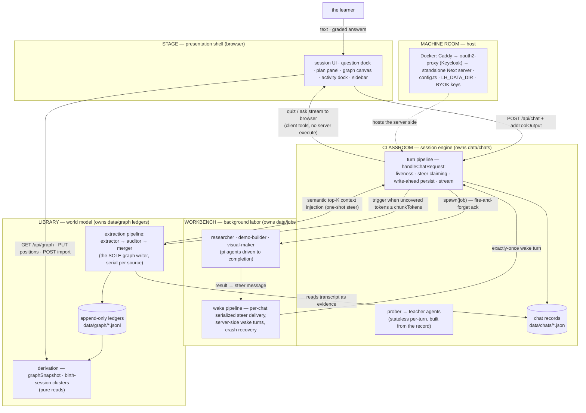

# Development guide

The developer README (split out of the storefront README, 2026-10-10). Everything below is for people working ON LearnHarness, not using it.

A self-hosted, browser-only learning app (Docker; see [`self-hosting.md`](self-hosting.md)): a **teacher agent** (Next.js; the native pi agent-event wire end-to-end, LLM engine [pi-ai](pi-engine-swap.md), bring-your-own-key across 30+ providers), probe→teach lessons with graded quiz/ask interactions, a formal **session plan tree** the teacher authors once (`plan_init`) and whose progress is derived from tagged quiz calls, and a persistent cross-session **knowledge graph** of what the learner knows — the graph is the app's home page.

Not a chat app with a graph bolted on: sessions are probe→teach lessons, the plan tree is a structured, schema-validated object, sessions accumulate into the graph through the extraction pipeline (propositions + reasoning chains — the stored truth; the canvas renders a derived image), and the teacher reaches back into the graph through read-only prober tools on its own judgment so probing compounds across sessions.

- [`docs/architecture.md`](architecture.md) is the **canonical architecture spec** — layers, the import law, the six systems, the invariants, the seam directory. (The pre-audit spec is archived under `docs/archive/` — history only.)
- Living design doc (all decisions): [`docs/vision.md`](vision.md)
- Build plan + wave/gate results: [`docs/plan.md`](plan.md)

## Commands

```bash
npm install          # once

npm run dev          # http://localhost:3000 (listens on localhost only)
npm run build        # production build (standalone output)
npm start            # next start (localhost only; the build is standalone, see below)

npm test             # the full suite (node:test via tsx; deterministic, no LLM, no network)
npm run lint         # eslint — includes the import law (architecture §2)
npm run typecheck    # tsc --noEmit

npm run dev:fresh      # a fresh-user instance: empty data, env keys hidden (port 3005, localhost only)

docker build -t learnharness:local .           # the image (runs the standalone gates + Chromium probe)
cd deploy && docker compose up -d --build      # the full stack (Caddy, oauth2-proxy, Keycloak)

# one-shot data scripts (run from the master tree only — data never crosses trees)
npx tsx --env-file=.env.local scripts/import-notes.ts <dir>   # bulk-import notes → graph
npx tsx --env-file=.env.local scripts/backfill-graph.ts       # wipe + re-extract every chat
npx tsx --env-file=.env.local scripts/replay-layout.ts        # re-derive layout from the ledgers
```

`npm run dev`, `npm start` and `npm run dev:fresh` listen on `localhost` only: a development server has no login (without `LH_MULTI_USER` every request is the implicit local user), so it must not be reachable from the network. To test from a phone on the local network, pass a later `-H`: `npm run dev -- -H 0.0.0.0` or `bash scripts/dev-fresh.sh --host 0.0.0.0`. Do that only on a network you trust. To run the standalone production build locally, build it with `node scripts/build-server.mjs` after `npm run build`, then run `HOSTNAME=localhost PORT=3100 node .next/standalone/server.js` (the standalone server takes its address from `HOSTNAME`; use `0.0.0.0` only on a trusted network). The Docker image is not affected: it runs `node server.js` and listens on the `HOSTNAME` the image or compose file sets.

Native renderer binaries (`@napi-rs/canvas`, `@resvg/resvg-js`) are traced for the build platform, so the image builds its own standalone payload on linux — never copy one in from another OS.

## Environment (`.env.local`)

Secrets and machine-specific paths only. Model choice and thinking budgets are the user's, not the environment's — BYOK model slots live in **settings** (`models` section: strong/cheap/vision, provider + model id + optional thinking level; per-role and per-chat overrides ride on top). The extraction batch threshold is a settings knob too (`graph.extractionChunkTokens`, default 4096, floor 500).

| Variable | Purpose |
|---|---|
| Provider API keys (`OPENROUTER_API_KEY`, `ANTHROPIC_API_KEY`, …) | optional in the environment — LLM calls go to whichever provider the model slots name, with the user's own key; at least one provider key is needed to chat. Normally an admin enters them in Settings → Providers; an env var, when set, wins and its row is read-only. The OpenRouter key also serves document embeddings and the OCR sidecar |
| web search key (see Settings → Providers for the supported engines) | optional — the researcher's `web_search`. Without one, `research` and `web_fetch` still work and `web_search` reports itself unavailable; an engine pinned in Settings → Agent needs its own key, with no silent fallback to another engine. Search keys are admin-set |
| `DEEPGRAM_API_KEY` | optional — dictation (STT token minting; audio streams browser→Deepgram, never through the server) |
| `CHROME_PATH` | Chrome/Chromium for demo verification (the Docker image sets `/usr/bin/chromium`; otherwise common install paths are probed — nothing is downloaded) |

The Docker image takes keys from `/data/auth.json` on the data volume (BYOK, mode 0600, read/written directly by the server via `LH_AUTH_FILE`; entered in Settings → Providers). PDFs render natively with pdfjs/Skia; SVGs use resvg.

## Architecture

Five layers, dependency arrows pointing inward only, machine-enforced as four ESLint zones (shell → barrels only; core and agent never import below themselves). Two composition roots, one writer per store. The full spec — layers, systems, runtime flows, invariants, seams: [`docs/architecture.md`](architecture.md).



**Core invariant:** the extraction pipeline (extractor → auditor → merger) is the sole graph writer — tree-blind and post-hoc, triggered by token coverage, not quiz counts. The LLM stages propose, verify, and judge identity (link-or-create against the current graph; each finding carries verbatim evidence and message-granular provenance); the deterministic merger owns every ledger append (ids, provenance, chain dedupe — the same argument re-asserted merges under one `arg_` id). Every node is an objective, world-facing fact; the learner's relationship to it lives entirely in practice records — feedback-only, never written back. The teacher stays a teacher; everything below the ledgers is derived.

## Layout

```
app/                            Next.js App Router — pages + 65 thin API route handlers
components/                     session + home UI, question dock, plan panel, graph
                                canvas + view, artifact renderers (registry: artifacts/),
                                dictation, activity dock, keyboard machine
src/
  agent/
    system-prompt.md            base teaching behavior (the methodology)
    prompts/{prober,teacher,practice,shared}/   composed numbered fragments (see prompts/README.md)
    teacher-agent.ts            prober/teacher factories (engine injectable for tests)
    tools.ts                    tool composition; quiz / ask_user_question (client tools)
    tools/plan.ts               plan_init (author-once mermaid plan, deterministic parser)
    tools/probe.ts              probe_done (probe→teach handoff seam)
    tools/jobs.ts               research / demo / visual tool surfaces
    tools/web.ts                web_search (keyed search port) + web_fetch (researcher only)
    subagents/                  researcher · demo-builder · visual-maker,
                                extraction pipeline (extractor/auditor + merger handoff),
                                runner (async protocol), native renderers + browser-service helper,
                                abort registry
  server/chat-handler.ts       THE turn composition root (liveness · steers · persist · stream)
  server/turn-service.ts       turn seams: persist · extraction trigger
  server/jobs.ts               the wake pipeline: serialized per-chat steer delivery,
                               server-side wake turns, crash recovery
  server/stores.ts              THE storage composition root — the one place adapters wire in
  server/turn-liveness.ts       per-chat turn registry (one turn per chat, ever)
  server/observability.ts       the activity feed (running jobs + extraction, abort)
  server/pi/                    the engine bridge: call-ids (tool-call id uniquifier)
                                · ui-stream (pi events → SSE, the native wire)
  server/index.ts               the server barrel (the only server import app/ may use)
  core/contracts/{plan,graph,chat,jobs,probe,models}.ts
                                the contracts — one file per domain
  core/ports.ts                 storage ports — ChatStore · GraphStore · JobStore
                                (core code depends on these types only)
  core/                         question-core, native-messages (record → pi messages), plan-tree, phases, pending, graph
                                (merger/derivation), coverage, layout, clusters,
                                prices, tool-parts — all pure: storage
                                arrives as parameters
  store/                        fs adapters implementing the ports: chats · graph
                                ledgers · jobs (+ render-settings, settings)
deploy/                         the self-hosting stack: compose.yaml, Caddyfile, Keycloak
                                realm import, .env.example (docs/self-hosting.md)
scripts/                        build-server.mjs (packaging guards), import-notes,
                                backfill-graph, replay-layout
data/                           chats/ · graph/ (nodes/chains/sessions/coverage
                                ledgers + positions/sources/render-settings maps) ·
                                jobs/ · settings.json — runtime state, git-ignored
```

## Key mechanisms

See [compaction and accounting](compaction-accounting.md) for the local Pi cutoff port,
measurement-only context meter, and server-side current-catalog pricing. There is no
pricing-generation step: Pi AI's catalog and public calculator are the authority.

**Client-side question tools.** `quiz` and `ask_user_question` have no server `execute`: the tool call streams to the browser, the learner answers in the dock, the client grades via `question-core` and returns the verdict with `addToolOutput` — which fires the SDK continuation so the teacher resumes mid-turn. Options are shuffled deterministically (seeded by toolCallId) so server and client renders match. A pending quiz persisted in the chat record is exactly what makes **resume mid-question free**.

**The formal plan tree (author-once).** The teacher authors the session's dependency tree with one schema-validated tool — `plan_init`, whose mermaid-subset input is parsed deterministically (line-numbered errors) and validated as a DAG. The tree persists in the chat record; progress is never mutated — `current`/`visited`/upcoming are **derived** from tagged quiz calls in the transcript, and the panel renders that derivation.

**The async sub-agent protocol (ack-and-steer).** `research` / `demo` / `visual` are server-executed tools: the call resolves immediately mid-turn with a fire-and-forget ack and the teacher keeps teaching; a background runner works in parallel (the client polls `/api/activity` and `/api/jobs`). On completion the runner builds a **steer message** — a user-role `subagent-steer` message whose text is the model-facing result and whose details carry the full result for the client (projected as a `data-subagent-artifact` part) — and the **wake pipeline** delivers it: a per-chat serialized queue waits for the turn to end and no question to be pending, then fires a server-side teacher turn that weaves the result into the lesson. Delivery is exactly-once (deterministic steer ids, delivered-flag checks at every claim point); stalled jobs are recovered on read; aborted jobs deliver an abort steer. The client adopts the wake turn through the same `turnInFlight` machinery as returning mid-stream (busy shimmer, composer gate) and renders steers as artifacts — never a bubble. Sub-agents **verify, never one-shot**: the demo-builder executes its HTML in the app's own Chromium browser-service (system Chrome fallback) before delivery; the visual-maker rasterizes each SVG natively and looks at it (vision-capable model — the `vision` slot in settings).

**The knowledge graph (two channels, one writer).** The write channel: the extraction pipeline — extractor (LLM: sees the source — the session's teacher prose or a notes chunk — plus its own source's digest (**THE GRAPH SO FAR**: propositions + chains already extracted from this source, ids verbatim — digest-aware redesign, 2026-09-30 evening: the extractor IS the assembler, referencing existing ids instead of restating, leaning on established conclusions as premises); fully trusted; its deliverable is core ideas + reasoning chains: premises that jointly entail a conclusion, submitted as chains and stored as chains — `chains.jsonl` is the truth, edges a derived view; owner redesign + chains-primary, 2026-09-30) → auditor (LLM, an agentic loop that never sees the source: reviews a preloaded, bounded set of ranked candidates (`find_candidates` for more) and stamps each proposition with an identity verdict — link to an existing node (equivalence bias: paraphrases merge) or create) → merger (`mergeFindings`, deterministic: applies the verdicts, link-appends phrasings/provenance, resolves and dedupes chains — identical arguments merge under one `arg_` id; then the chain-simplification pass strips provably redundant derivations — derivability over the chains still standing — checkpoints coverage) → layout settle. A source's batches run strictly in order (each extractor continues the digest of every earlier merge). No quiz outcomes or understanding assessments live in the graph (2026-09-27 cleanup); practice (`/practice`) consumes the graph as feedback-only problem sets and writes nothing back. Triggered when a chat's **uncovered tokens** (message-view fingerprints, `coverage.jsonl`) cross `graph.extractionChunkTokens` (a settings knob, default 8192, floor 500 — read fresh per turn); failure checkpoints nothing, the next trigger re-runs (a batch that failed 3 times in a row is skipped by the trigger until it changes, the process restarts, or the learner requests extraction). The same pipeline serves the **notes front door** (`POST /api/graph/import`: any `*.md`/`*.txt` becomes a source; re-imports are idempotent by path hash). The read channel: `GET /api/graph` derives the snapshot from the ledgers — a pure read (`deriveView` rebuilds the lossy image: each chain an implication node `⟹` with premise→implication→conclusion arrows, so two arguments for one conclusion stay two diamonds); the home view is a hand-rolled Canvas 2D renderer (one rAF loop, dirty-flag idle, d3-zoom camera, zoom-gated labels, cluster hulls) over a d3-force layout, with server-persisted render settings and drag-committed positions. Clusters are **birth-session groupings**: a node joins the cluster of the session that birthed it (a chat, or an imported notes file as a file-kind session), derived at read — no embedding pass, no naming pass. The teacher reaches the graph on its own terms through the gated prober tools (`list_sessions` / `list_propositions`, the `agent.graphTools` setting) — there is no automatic context injection.

**Practice (a chat session kind).** Practice is a chat session kind (`ChatRecord.kind === "practice"`; absent means teach), with its own prompts in `src/agent/prompts/practice/` and tools `problem`/`conclude` in `src/agent/tools/practice.ts`; it does no extraction and writes nothing to the graph.

**Dictation.** Optional speech-to-text: the server mints short-lived Deepgram tokens; audio streams browser→Deepgram over WebSocket, never through the server.

## Testing

All deterministic, no LLM, no network (engines are injected — pi-ai's faux provider scripted per test; `globalThis.fetch` stubbed where transport matters):

1. **Pure core units** — merger (via the real fs adapters, in a per-process temp data dir from the `tests/setup.ts` preload), derivation, coverage, question grading, plan tree, phases, clusters, layout, tool-parts, prices.
2. **Server flows** — `handleChatRequest` driven end-to-end with scripted engines: persistence, liveness, steer claiming, the wake pipeline (409 retry, quiz deferral, idempotency), crash recovery, the data-dir seam (including a fresh child process).
3. **Sub-agent loops** — researcher/demo-builder/visual-maker with fake headless APIs; the extraction pipeline end-to-end (audit drops, failure-checkpoints-nothing, single-flight, abort).
4. **Render tests** — transcript, cards, docks, composer, sidebar, coverage via React server-side rendering.
5. **Golden fixtures** (`tests/fixtures/golden-data/`) — a REAL data dir (real records produced by the app, never hand-edited), copied to a temp dir and read through the production paths via the `LH_DATA_DIR` seam. Pins that real data parses, flattens to a legal LLM wire, derives the graph end-to-end, covers every custom-marker kind, and that reads never write. **The fixture law:** an intentional on-disk format change updates the fixtures in the same commit — see the fixture README.

## Lineage

The teaching methodology comes from an Obsidian-based POC (its `knowledge graph design.md` was the original epistemic-model source, since amended — see the amendments table in `docs/vision.md`). The harness was originally built on the pi agent SDK, pivoted to standalone Next.js + the Vercel AI SDK, and later swapped its LLM engine back to pi-ai, while the AI SDK's `UIMessage` client protocol has since been dropped for the native pi event wire ([`docs/pi-engine-swap.md`](pi-engine-swap.md)).

## Data

Nothing under `data/` is ever tracked by git. Chats, graph ledgers, jobs, positions, and the settings records are plain files (JSON/JSONL) — inspect them freely; they are the canonical records. The Docker image relocates the whole directory via `LH_DATA_DIR` (the `/data` volume).

**Schema stamps (2026-10-10):** chat records carry `version` (stamped at the store's write choke point; absence reads as v1 — lazy migration, no mass rewrite), and the graph family (ledgers, sources, render-settings) shares one sidecar `graph/format.json`, created on the family's first write. `positions.json` is deliberately unstamped (rebuildable). A record stamped NEWER than the running build is refused on read — honest refusal for the downgrade scenario: a read-modify-write store never rewrites what it doesn't understand.